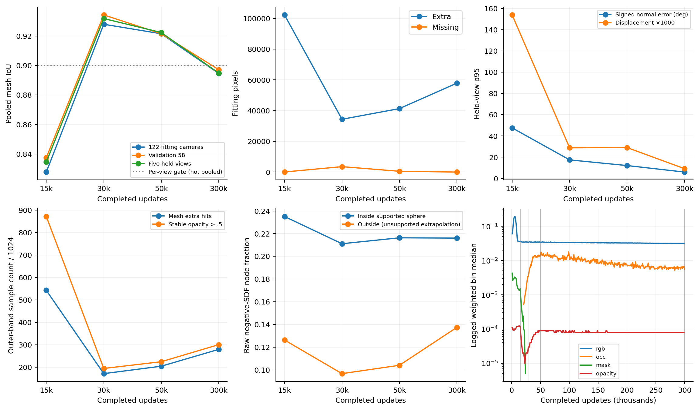
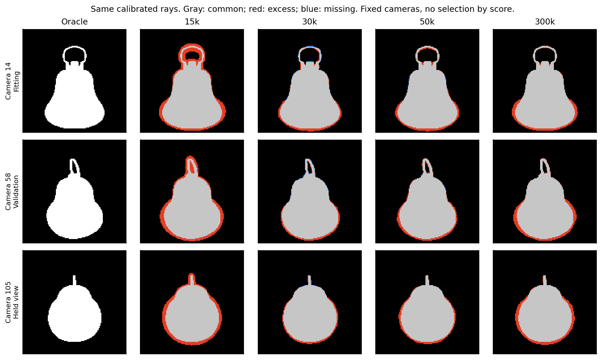
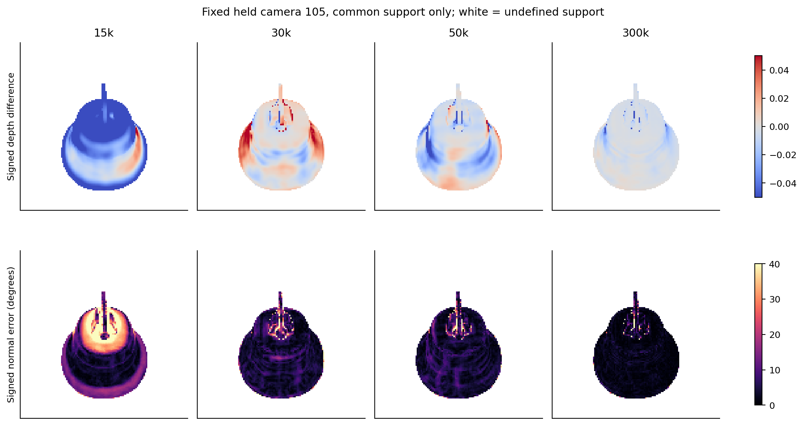

# Gate 10.3 — Verified geometry evolution; geometry admission remains blocked

**The authorized evaluation completed. The offline verifier needed a one-ULP
normal-summary comparison correction; no GPU work was repeated. The fixed 300k
geometry still fails admission.** Excess support is present in fitting views by
15k, decreases by 30k and then grows toward 300k. On the fixed sampled panel,
mesh excess consistently coincides with stable foreground opacity, motivating a
controlled background-opacity diagnostic before direct free-space SDF supervision.
This is evidence for an intervention, not proof that an intentional mask loss
caused the observed geometry or that the intervention will work.

[Numerical summary](results-v2/summary.json) · [Per-camera metrics](results-v2/per-camera.csv) ·
[Neural panel](results-v2/neural-panel.csv) · [Offline verification](results-v2/verification.json) ·
[Artifact manifest](results-v2/artifact-manifest.json)

## Execution, preservation and replay correction

Native commit `53662125ba4184bc9bb48d7a6845a4358aa04fcb`, freeze
`e027b4ab9320049086b4e3d7b83c47646f6b228cf9399b43a015a84b089bb862`,
authoritative G `79252178e65914ad1acbc14790b1514f276bfea0` and the frozen corrected
image/BVH were used. The four authenticated checkpoints were loaded once each
on CPU. Only 30k/50k were newly extracted. The completed failed-v1 15k extraction,
six-view audit/SDF witnesses and accepted Gate 10.2 300k candidate/audit were
reused byte-for-byte. All original training, failure, source, freeze, authorization,
mesh and dense-field evidence remains unchanged. No G→A handoff was created.

Native batch:
`/home/isavand/paper/evidence/bell-geometry-gate103-v2-ad4a430c57b149f58a6b936ede1f017d`.
Separate file-only finalization:
`/home/isavand/paper/evidence/bell-geometry-gate103-v2-ad4a430c57b149f58a6b936ede1f017d-offline-v3`.
All 756 native artifact identities and recorded scientific inputs verify; the
native receipt is complete, host exit is zero and cleanup/container absence pass.
G/A source manifests remain unchanged (99/106 files), and native checks confirm
unchanged checkpoint state and no accumulated parameter gradients.

The original host verifier stopped on exact equality of two normal-angle summary
statistics: camera 61 at 30k (p95) and camera 98 at 50k (mean). Their differences
are 3.552713678800501e-15 and 8.881784197001252e-16 degrees, respectively, one
float64 ULP each. Across all **488 fitting camera captures**, every eligibility
mask, count, classification and scientific pass/fail flag matches exactly. All
four six-camera and SDF replays also match exactly. The separately versioned
[offline replay rule](../../protocols/BELL_GEOMETRY_GATE103_OFFLINE_REPLAY_V3.md)
allows only adjacent finite float64 values in normal-angle summary statistics;
every other field remains exact. Missing/extra/nonfinite values or larger
differences fail. Fourteen focused CPU cases pass. The original verifier and
captured results are not changed or replaced; both roundoff events are logged.

The v2 camera witness also localizes the earlier camera-prefix problem on camera
14: default TF32-enabled CUDA origin error is **0.0003743171691894531**, compared
with zero when TF32 is disabled; direction errors are 1.1920928955078125e-7.
The adopted CPU camera prefix matches archived origins/directions exactly and
keeps the original 2e-6 gate. TF32 settings are restored before rendering. This
is a controlled camera-arithmetic witness, not proof about all GPU operations.
The audit does not claim bitwise replay of historical training rays or RNG state.

| New work/resources in v2 | Observed |
| --- | --- |
| Native time | 1,364.481 s (22.74 min) |
| Peak host RSS / CUDA allocated | 6.816 / 1.828 GiB |
| Checkpoint CPU loads | 4 |
| Dense grids / tiles / SDF nodes | 2 / 1,024 / 268,435,456 |
| Marching-cubes calls | 2 |
| New BVH rays / independent CPU witnesses | 8,388,608 / 1,024 |
| Consistency SDF / gradient points | 3,072 / 1,024 |
| Neural renders / rays | 128 / 32,440 |
| Neural SDF forward / gradient slots | 28,373,179 / 6,007,506 |
| Appearance calls / point slots | 128 / 3,003,753 |
| Original occlusion origins | 196,608 |
| Optimizer updates / new checkpoint writes | 0 / 0 |

Offline work read saved arrays and produced plots only: no checkpoint
deserialization, model construction, SDF query, new ray query or neural render.

## Geometry evolution

The table pools full rasters within each split. Admission remains **per camera**,
not a pooled-IoU decision. All four original checkpoints are retained, including
failed quality outcomes; 300k remains the fixed publication endpoint.

| Completed updates | Fitting IoU | Fitting extra / missing pixels | Fitting valid correspondence | Fitting passing views / 122 | Validation IoU | Held pooled IoU | Held passing views / 5 |
| --- | --- | --- | --- | --- | --- | --- | --- |
| 15k | .827746 | 102,253 / 57 | .383332 | 0 | .837533 | .834567 | 0 |
| 30k | .927981 | 34,360 / 3,526 | .861376 | 106 | .934300 | .931850 | 4 |
| 50k | .921546 | 41,304 / 512 | .894230 | 113 | .921590 | .922387 | 5 |
| 300k | .894696 | 57,872 / 0 | .985959 | 51 | .897214 | .894891 | 2 |

At 300k the fitting precision is .894696 and recall is 1.0; held precision is
.894891 and recall is 1.0. Thus the endpoint's failure is excess support rather
than missing foreground. Fitting and held silhouettes have similar pooled IoU:
this is not solely a held-view generalization failure. The frozen six-view gate
fails at cameras 58/105/114/76, as already established in Gate 10.2.

The 30k camera 114 fails correspondence despite IoU .926758. All six original
view gates pass at 50k in this diagnostic, but **50k is not selected or admitted
as a replacement endpoint**. These cameras now provide development evidence.

| Completed updates | Held displacement median / p95 | Held signed-normal median / p95 (degrees) |
| --- | --- | --- |
| 15k | .032234 / .153884 | 8.760 / 47.602 |
| 30k | .006877 / .028884 | 3.968 / 17.480 |
| 50k | .006513 / .029049 | 3.990 / 12.161 |
| 300k | .002423 / .009230 | 1.588 / 6.026 |

Closest-surface depth/normal accuracy on common support improves while silhouette
precision later deteriorates. High correspondence therefore does not certify a
correct occupied silhouette. All maxima/tails remain in the numerical summary;
for example, 300k held displacement maximum is .629255 and signed-normal maximum
151.354 degrees. No outlier is deleted. This study does not redefine signed
normals, flatten failures into an unsigned normal score, or certify mesh interiors.

Cameras 14, 58 and 105 were fixed for visualization, not selected by error. Gray
is common support, red excess and blue missing. Equal-width checkpoint columns
are categorical; the loss panel alone uses elapsed update spacing. Logged loss
medians retain the original precision; printed zero cannot establish zero loss
or parameter gradient. The plotted zero/nonfinite log-scale entries are omitted.

Camera 105's maps use fixed signed-depth ±.05 and normal-angle 0–40° display
scales, with white for undefined support. These display limits do not clip any
numerical metric or remove extreme observations. Figures are also saved as PDFs.

## Fitting opacity versus zero-level mesh support

The geometry-only fixed 16-camera panel contains 4,055 unique rays per checkpoint
per draw, with two common training-policy draws. It is a stratified diagnostic,
not a probability sample or a full-raster neural IoU estimate. The four strata
overlap; their counts must not be added as independent observations.

| Updates | Unique-panel mesh false positives | Same mesh false positives with opacity >.5 in both draws | Stable-low-opacity mesh false positives | Stable opacity false positives (including no mesh hit) | Threshold flips |
| --- | --- | --- | --- | --- | --- |
| 15k | 599 | 599 | 0 | 988 | 0 |
| 30k | 192 | 192 | 0 | 223 | 1 |
| 50k | 233 | 233 | 0 | 257 | 0 |
| 300k | 313 | 313 | 0 | 343 | 2 |

All measured mesh false positives have stable high foreground opacity; none is
an observed low-opacity/zero-level-only discrepancy. At 300k, 30 additional
stable-high-opacity background rays have no mesh hit. In the 1,024-ray outer-band
stratum, 280 mesh excess hits and 301 stable-opacity false positives remain.
The broad 1,024 background stratum has 34 and 43 respectively. Two draws identify
few threshold flips, not a converged Monte Carlo confidence interval.

These findings favor a direct opacity diagnostic first. They do not prove that
the foreground-only term caused the geometry, exclude sampling effects elsewhere,
or establish that direct SDF constraints will never be useful. Original full-image
RGB/background-NeRF compensation and label-free entropy remain possible interacting
mechanisms. No new training establishes their causal roles here.

## Domain support, negative extension and schedules

At 300k, **52,533 of 57,872 fitting extra hits (90.8%)** lie radially deeper than
the conservative domain-boundary omission band. The measured excess therefore
is predominantly interior to that radial band, rather than just a displayed
unit-sphere closure. All counted missing fitting observations at earlier steps
have supported-domain labels; none is attributed to unsupported-domain omission.
This does not rule out indirect visibility effects from open boundaries.

| Updates | Components | Open edges | Raw negative nodes inside sphere | Raw negative nodes outside (unsupported) | Raw negative fraction in fixed lower cube y<−.65 |
| --- | --- | --- | --- | --- | --- |
| 15k | 1 | 1,873 | 23.509% | 12.631% | 58.394% |
| 30k | 1 | 1,619 | 21.112% | 9.671% | 49.131% |
| 50k | 1 | 1,625 | 21.633% | 10.406% | 51.247% |
| 300k | 6 | 1,803 | 21.607% | 13.745% | 60.676% |

Negative-grid summaries replay exactly from all four saved fields. These are
cube/node statistics, not surface areas or proof of supported exterior geometry.
Raw negative values extend across domain edges at every checkpoint. The original
sentinel can turn such extension into artificial sphere closure, as Gate 10.1
established; the current policy excludes that closure without oracle trimming.
Exact cleanup/topology maps and open components remain intact, and all original
raw-SDF zero/gradient/crossing quality gates pass. This establishes consistency
with learned SDF, not accuracy against the oracle or safety of unseen visibility.

Source schedules are unchanged. Stored step t corresponds to completed updates;
the last training forward was loop index t−1. Trainable inverse variance begins
at 15,000; occlusion and opacity ramps start at 20,000 and reach their final phase
at 50,000; mask weight reaches one at 30,000 and alpha annealing completes at
50,000. Effective curvature weight is .001 throughout. RGB, mask, entropy,
occlusion, background appearance and learning rate evolve together. Four snapshots
cannot identify which schedule causes the later excess. The original evidence's
low foreground mask loss is compatible with background excess because that loss
intentionally has no direct background derivative; it is not an implementation bug.

## Decision and smallest next task

**Evaluation: PROCEED, complete and verified. Geometry admission/G→A: BLOCKED.**
Retain 300k and its original criteria; do not substitute the 50k checkpoint.

Prepare one isolated perfect-mask diagnostic O1 against the existing authenticated
O0 history: same original G, Bell v3 acquisition/split, seed, schedules and 300k
budget, adding only `mean((1-m)*fg_acc)` under the original mask schedule and
full-ray denominator. Preserve the exact L1 foreground expression. Coefficient
one is the prospectively specified symmetric diagnostic, not a searched optimum.
This is a synthetic oracle-mask control, not the proposed realistic method.

For realistic supervision, preserve the thesis rationale: imperfect SAM2-negative
pixels are unknown. A same-imperfect-mask baseline and confidence-aware trimap
pair is the first lower-cost candidate supported by the opacity observations.
No GT mask, geometry, depth or held-view outcome may choose confidence thresholds,
prompts, margins or loss support. Direct multi-view free-space SDF remains a
separate conditional candidate with matched confidence support.

The [versioned research backlog](../../RESEARCH_BACKLOG_GATE103_V2.md) specifies
the O1 diagnostic and realistic comparison. Background opacity is established
supervision, while confidence-aware/anisotropic geometry methods require separate
validation before novelty or effectiveness claims. The existing Bell views are
development data; freeze a resulting method before independent confirmation on
another dense scene or a prospectively reserved acquisition. No optimization,
segmentation, architecture change or material training was launched here.
