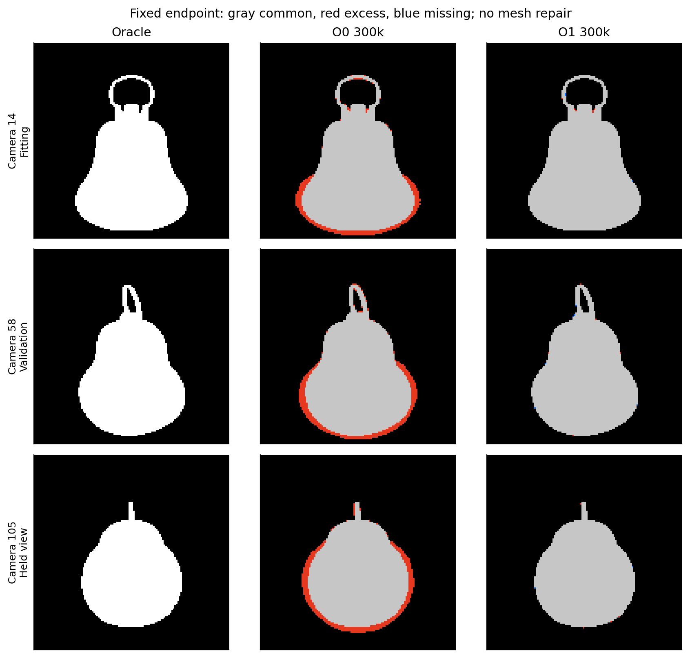
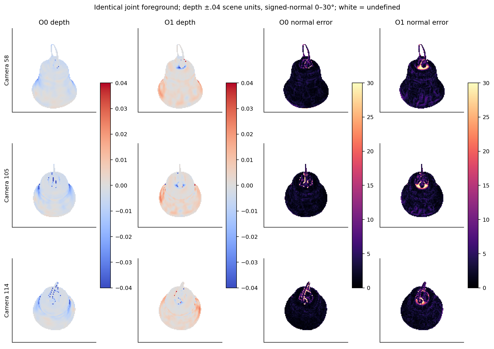
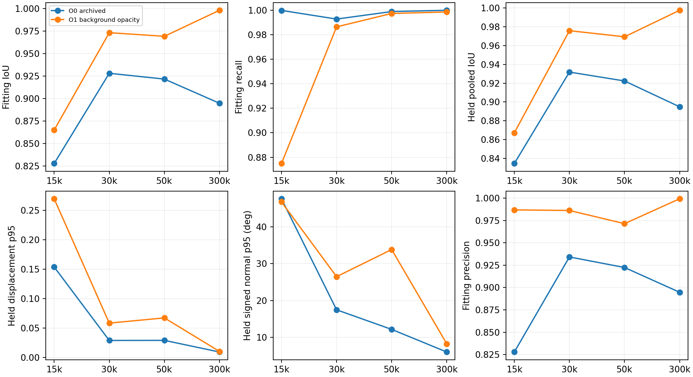
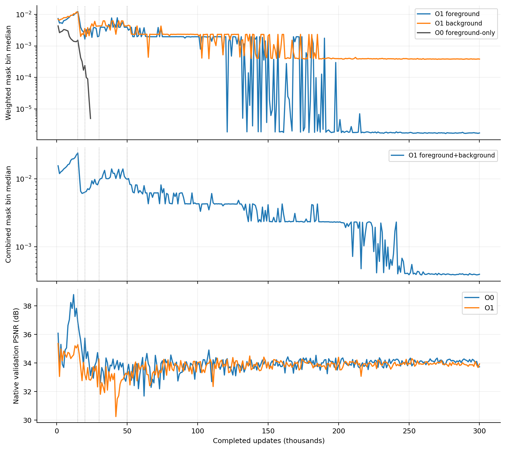

# Publication Gate 11 — O1 background-opacity diagnostic

**PROCEED: the complete 300k O1 diagnostic is verified and passes the frozen
geometry eligibility criteria. It is not admitted automatically.** No original-G
handoff is created. O0's original failed admission remains unchanged.

O1 nearly eliminates excess silhouette support, with a small loss of foreground
recall. Common-support median displacement improves, but p95 depth/displacement
and signed-normal accuracy deteriorate. This is a successful perfect-mask support
diagnostic with measurable tradeoffs, not uniformly better physical geometry or
evidence of robustness to imperfect SAM2 masks.

[Final summary](results-v1/summary.json) · [Prepared full comparison](results-v1/prepared-comparison-summary.json) ·
[Per-camera metrics](results-v1/prepared-per-camera.csv) · [Common-support errors](results-v1/joint-support-errors.csv) ·
[Verification](results-v1/verification.json) · [Artifact manifest](results-v1/artifact-manifest.json)

## Identity, lifecycle and verification

The authorized source was `2d5a1ac0d2f04e701e0a75276d7ac67aee1ad9a1`, freeze
`4b09eb7871eb2f0d8e52f142a814d7148808a3908320c464d8d4d05a003cc81c`,
variant **G_background_opacity_oracle_v1**, based on unchanged authoritative G
`79252178e65914ad1acbc14790b1514f276bfea0`. The corrected image/BVH, Bell v3
acquisition, 122/1/5 split, seed 6033 and all original schedules were preserved.
The only objective change was `mean((1-mask)*fg_acc)`, coefficient 1, added to the
exact original foreground L1 before its original mask schedule. No coefficient
search, scene-specific appearance change, SDF initialization change or other
regularizer was introduced.

Initial network fingerprint matched O0 exactly:
`9c7b468700061fa7f45fa132fd20bb03e982d52184fdbeed4263fd4200027dd4`.
The natural 1k lifecycle gate passed with the owned CPU checkpoint roundtrip and
137 tensors. The first Adam return at zero LR had no parameter displacement;
the second had nonzero displacement and advancing finite moments. All 300,000
original returns, 300 natural validations/saves, six retained intermediate
checkpoints, 300,000 derivative mask calls and 15,006 component rows completed.
Every logged training loss and sampled phase-gradient witness was finite. G uses
no gradient clipping; these witnesses do not measure every individual component's
parameter-gradient direction.

Both native phases exited 0, native cleanup and owned-container absence verify.
The original committed verifier was replayed in full to a separate directory;
its JSON matches the launcher's original verification exactly, with **zero
roundoff events or substantive mismatches**. All 1,364 files listed in the original
manifest verify, including the captured arrays/checkpoints. The original manifest
itself is separately hash-bound. No original receipt or artifact was rewritten.

Native batch:
`/home/isavand/paper/evidence/bell-background-opacity-gate11-a8d84c48f9a04864a659b10786bd23b9`.
Separate file-only finalization:
`/home/isavand/paper/evidence/bell-background-opacity-gate11-a8d84c48f9a04864a659b10786bd23b9-finalization-v1`.
Large checkpoints, grids and meshes remain outside Git. Three focused result
tests cover common-support accounting, extreme tails and incomplete loss logs;
the previously accepted 19 preparation tests were not repeated.

| Endpoint artifact | SHA-256 |
| --- | --- |
| Newly produced step300k checkpoint | b9a5fb4c461de77ec9f387466e05373f959df65baebd5151f02278d1648c46e7 |
| Endpoint network tensors | be503777da9952bed39a1a9397df730c1720a5fe8cb262a47c49ca2cdddb64a8 |
| Domain-aware float32 candidate PLY | 0becad75d5f5404b84f5a154870eaf66e71f00ba5b843776f50dd6b1989d7ac3 |

The candidate is `evaluate/300000/candidate.ply`, with 918,185 retained faces.
It is an authenticated **O1 derivative** output, not the unchanged-original-G
method. No `oracle-admission.json`, geometry admission or original-G handoff was
created. Native evaluation loaded only the four new owned checkpoints; together
with the natural 1k roundtrip there were exactly five specified CPU loads.
All finalization work used saved files only: zero new checkpoint loads, SDF
queries, native rays, neural renders, optimizer updates or segmentation calls.

## Fixed 300k endpoint: support and correspondence

Values below pool full rasters within each split. The admission criteria remain
per camera; pooled scores do not substitute for those gates. Valid correspondence
uses the original signed-normal/distance criteria, with all exclusions retained.

| Split / method | Precision | Recall | IoU | Excess / missing pixels | Valid correspondence |
| --- | --- | --- | --- | --- | --- |
| Fitting O0 | .894696 | 1.000000 | .894696 | 57,872 /0 | .985959 |
| Fitting O1 | .999355 | .998617 | .997974 | 317 /680 | .982438 |
| Validation 58 O0 | .897214 | 1.000000 | .897214 | 476 /0 | .984597 |
| Validation 58 O1 | .998796 | .998556 | .997356 | 5 /6 | .984597 |
| Five held views O0 | .894891 | 1.000000 | .894891 | 2,331 /0 | .983775 |
| Five held views O1 | .999193 | .998388 | .997583 | 16 /32 | .983372 |

Fitting excess falls 99.45%, held excess 99.31%. Recall falls 0.1383 percentage
points in fitting and 0.1612 points in held views; these lost observations are
explicit failures, not removed from coverage. All 680 missing fitting pixels are
in the supported-domain cohort. All 317 remaining fitting extra hits lie deeper
than the conservative radial domain-boundary band.

All 122 fitting views pass their recorded view criteria. More importantly, each
of the six original validation/held views passes the unchanged admission gates:

| Camera | IoU | Valid oracle fraction | Excess / missing |
| --- | --- | --- | --- |
| 58 | .997356 | .984597 | 5 /6 |
| 11 | .997260 | .984007 | 3 /9 |
| 105 | .998338 | .977266 | 4 /2 |
| 114 | .997986 | .987050 | 1 /6 |
| 17 | .997251 | .986706 | 3 /9 |
| 76 | .997270 | .981362 | 5 /6 |

All four checkpoint SDF consistency gates pass. At the primary endpoint,
497/512 witnesses are eligible under the original domain/sign conventions,
with zero interior failures and zero unsupported near-sphere failures. Every
ineligible sample remains in the saved witness arrays. Eligibility is a bounded
quality check, not proof of globally correct surfaces or future shadow visibility.

Fixed cameras 14/58/105 were used, as in the earlier diagnostic figures. Gray is
common support, red excess and blue missing. No component or observation was
selected or repaired to improve these maps.

## Physical error tradeoff on identical support

The prepared independent-common-support comparison already shows deterioration:
held displacement p95 changes .009230→.010261 and signed-normal p95
6.026→8.244°. To avoid comparing different physical pixels, the supplementary
table below uses the exact joint oracle/O0/O1 foreground: 491,017 fitting,
4,149 validation and 19,814 held observations. Missing O1 observations remain
counted separately above; they do not disappear from the evaluation.

| Held-view metric on 19,814 identical pixels | O0 | O1 |
| --- | --- | --- |
| Absolute depth median | .002419 | .002004 |
| Absolute depth mean | .003828 | .003395 |
| Absolute depth p95 | .009192 | .010261 |
| Absolute depth p99 | .019930 | .021442 |
| Absolute depth maximum | .629255 | .478532 |
| Signed depth median | −.002345 | +.001653 |
| Signed-normal median | 1.586° | 2.334° |
| Signed-normal mean | 2.750° | 3.467° |
| Signed-normal p95 | 5.947° | 8.244° |
| Signed-normal p99 | 25.814° | 25.781° |
| Signed-normal maximum | 143.955° | 144.228° |

Along a common calibrated ray, absolute depth and Euclidean displacement agree
up to stored-coordinate rounding. The complete table preserves both. O1 improves
typical depth/displacement but worsens its p95/p99 and most signed-normal
statistics. Its signed depth bias changes from predominantly closer to
predominantly deeper than the oracle. Validation also deteriorates: matched
absolute-depth p95 .008564→.011098, maximum .113091→.237899, and normal p95
5.706→8.546°. Fitting matched displacement p95 rises .008307→.009564.
These are genuine physical tradeoffs, not roundoff or threshold adjustments.

The comparison uses identical per-camera support and fixed display scales:
depth ±.04 scene units and signed-normal 0–30°. White indicates undefined support.
Display saturation counts are saved; no numerical metric is clipped. The maps
show larger O1 normal errors near the neck and visible band structure. They do
not establish whether appearance mismatch, curvature, opacity or another coupled
mechanism explains those errors. No new appearance intervention was run.

## Trajectories and mask components

| O1 checkpoint | Fitting IoU / recall | Held IoU / recall | Held valid correspondence | Held displacement p95 | Held normal p95 |
| --- | --- | --- | --- | --- | --- |
| 15k | .864874 /.874899 | .867221 /.878363 | .004485 | .269841 | 46.759° |
| 30k | .973085 /.986455 | .975889 /.989116 | .614683 | .058368 | 26.473° |
| 50k | .969070 /.997413 | .969378 /.998539 | .589338 | .067265 | 33.833° |
| 300k | .997974 /.998617 | .997583 /.998388 | .983372 | .010261 | 8.244° |

Early silhouette improvement did not mean good 3D geometry: no original view
passes the full criteria at 15k/30k/50k because correspondence remains inadequate.
O1's physical recovery is much later than O0's measured 30k/50k recovery. Only
the frozen 300k endpoint is primary. No intermediate checkpoint is selected;
the retained 100k/200k files were not additionally deserialized or extracted.
Temporal overlap with original loss phases does not isolate their causal roles.

All15,006 component rows exactly replay the float32 addition of original
foreground loss plus background loss. Original schedule replay is exact, with
zero one-ULP events. Both parts retain the **full 512-ray denominator** and the
same original schedule. Component values are batch means, not full-image failure
fractions or measured component parameter-gradient directions.

At 300k the recorded raw foreground term is 1.8347055e-6, background 3.6921923e-4,
total 3.7105393e-4 and coefficient 1. O0's recorded original foreground-only term
is1.81608e-6. Thus a tiny foreground term can coexist with O0's large background
excess, while O1 keeps direct background pressure. A single low batch loss does
not certify recall on every camera.

The last 10k logged rows have median weighted foreground 1.74029e-6, median
background 3.83467e-4 and median total 3.91189e-4. These are separate medians and
need not sum. Background and foreground fluctuate earlier; no coefficient or
schedule was tuned after observing them. Logged five-decimal zeros in the old
native logs are not proof of zero loss/gradient.

Native validation 58 improves modestly from PSNR 33.7264/SSIM.939866 to
33.9293/.943054. These are original G display-domain validation definitions,
not new linear-radiometry scores. They do not replace geometry metrics.

## Opacity, negative extension and topology

The unchanged 4,055-ray-per-draw fixed neural panel is not a probability sample
or full-raster neural silhouette estimate. Two draws quantify stability, not
converged Monte Carlo uncertainty. Its overlapping strata are never added as
independent samples.

| 300k unique panel | O0 | O1 |
| --- | --- | --- |
| Mesh false positives | 313 | 1 |
| Stable opacity false positives (> .5 in both draws) | 343 | 1 |
| Mesh false negatives | 0 | 14 |
| Stable opacity false negatives | 0 | 8 |
| Threshold flips | 2 | 1 |

The single O1 mesh false positive has stable high opacity; no stable-low-opacity
mesh excess appears in this panel. At15k O1 had 44 mesh false positives but 538
mesh false negatives and 227 stable-opacity false negatives. These persist in
coverage accounting rather than being removed as difficult observations.

| 300k domain/mesh statistic | O0 | O1 |
| --- | --- | --- |
| Negative raw SDF nodes inside supported sphere | 21.607% | 19.966% |
| Negative raw SDF nodes outside (unsupported) | 13.745% | .1694% |
| Negative raw SDF in fixed lower cube y<−.65 | 60.676% | 19.414% |
| Edge-connected components after extraction | 6 | 144 |
| Open boundary edges | 1,803 | 2,495 |
| Nonmanifold / inconsistent two-face edges | 0 /0 | 0 /0 |
| Total candidate area | 3.759077 | 4.704391 |

The raw sign statistics are existing-grid measurements, not areas or proof of
valid geometry outside the supported sphere. O1 reduces negative extension but
does not eliminate it; the accepted domain-aware extraction is still required.
At O1's endpoint exactly 4 equal-coordinate merges and 8 exact-zero-area removals
occurred, leaving 918,185 faces. Every positive-area face and disconnected component
survives. No small-area filter, hole fill, mesh repair or normal flip was used.

O1's largest component has 917,722 faces. All 143 secondary components together
account for .03075% of candidate area. These are components **after domain
selection** and may have connections outside supported cells; they are not
identified as physical isolated objects. All 2,495 open-edge midpoints lie within
the original .006779-deep radial omission band (radii .994469–.999881), as do
O0's edges. Open boundaries can still alter later incident visibility. The
global oracle area 5.231501 includes different domain/support and is not an
area-matching objective or proof that a candidate is more accurate.

## Cost, interpretation and next task

O1 training took 39,295.08s (10.915h), versus archived O0's 39,469.19s (10.964h),
ratio .99559. This is total run time under system load and geometry-dependent
work, not a negative isolated overhead for the new term. Four-checkpoint O1
evaluation took 1,504.18s (25.07min). Peak training RSS/CUDA allocation were
9.396/7.453GiB, evaluation 6.941/1.798GiB, below frozen limits.

New evaluation work was exactly four 512³ grids/536,870,912 SDF nodes, four
extractions, 8,781,824 BVH rays and 1,792 passing independent FP64 witnesses.
Consistency used 6,144 SDF and 2,048 gradient points. The fixed neural panel used
128 renders / 32,440 rays, 28,394,632 SDF forward slots, 6,021,808 gradient slots
and 196,608 original occlusion origins. All counters satisfy the freeze; no extra
native execution occurred during finalization.

On this matched single-seed synthetic case, the controlled background-opacity
addition substantially resolves excess support, with the tradeoffs documented
above. It does not make the original intentional foreground-only loss a bug.
That objective was designed for high-precision incomplete SAM2 masks, whose
unlabeled pixels are unknown. O1 cannot establish realistic segmentation robustness,
individual-component effects elsewhere, statistical significance or cross-object
confirmation. Existing Bell views remain development evidence.

**Recommended next task:** researcher review of this O1-identified candidate
for admission, followed—if admitted—by one small fixed-material RGB/visibility
comparison on oracle versus authenticated O1 geometry before material recovery.
This addresses the remaining normal/depth and open-boundary visibility risks
without new optimization or a coefficient sweep. No such rendering was launched.

The already frozen fitting-image-only SAM2/trimap and same-mask R0/R1 design
remains the next separate realistic-supervision validation branch. Its thresholds,
prompts and margins were not changed using these outcomes. No SAM2, R0/R1,
material, external-baseline or additional geometry training was executed.
