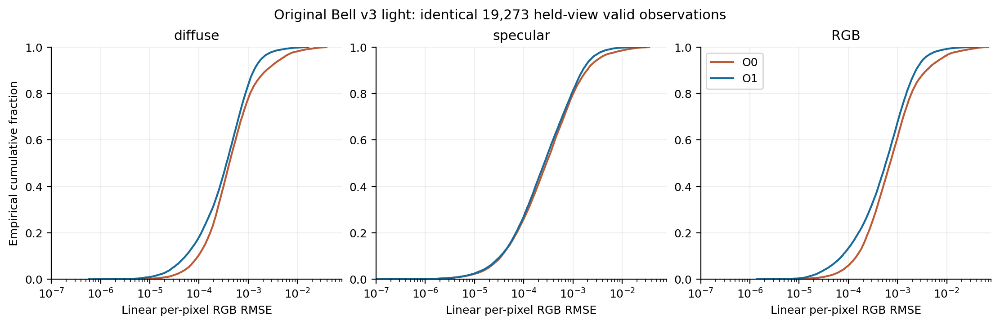
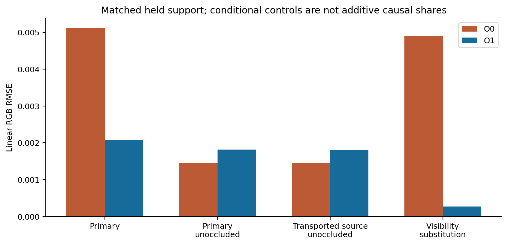
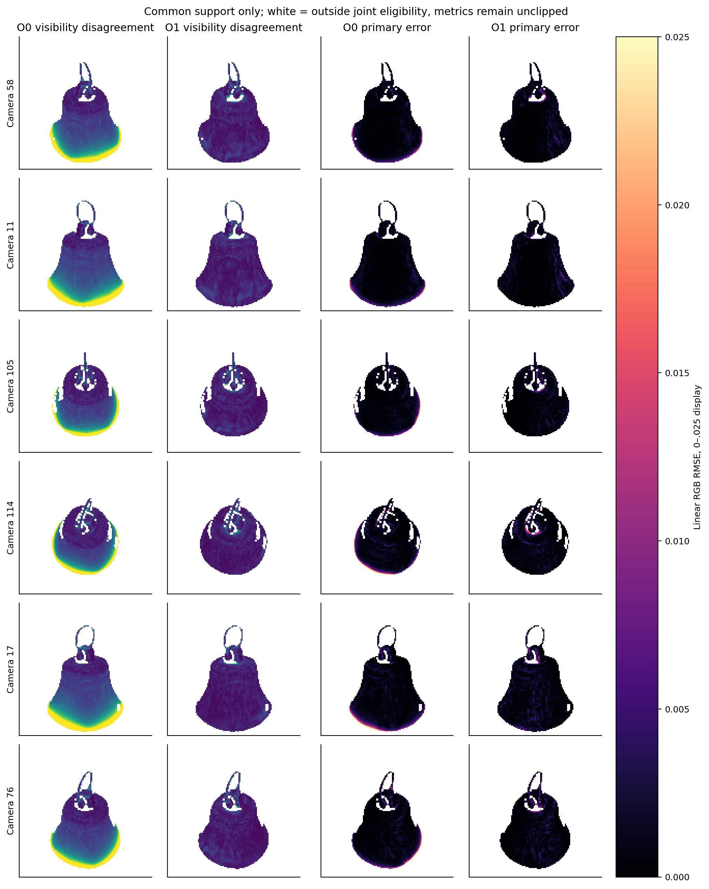

# Gate 12 — Authenticated geometry-to-rendering sensitivity

**PROCEED to a separately authorized matched oracle/O1 material-recovery study.**
The one approved rendering batch and its frozen offline verifier completed.
O1 improves defined fixed-material rendering under the original Bell v3 light,
including on identical O0/O1 support, despite worse unoccluded normal/frame
accuracy. It remains an explicitly **perfect-synthetic-mask-assisted derivative**;
O0 remains diagnostic-only and its geometry admission is still blocked.

This does not establish full-raster rendering accuracy at undefined hits,
material identifiability, realistic-mask robustness, or an attainable/irreducible
inverse-rendering bound. No material training, sharper-light rendering or SAM2
inference was launched.

[Frozen metrics](results-v1/original-metrics.json) · [Matched controls](results-v1/supplemental-summary.json) ·
[Per-camera/split/tail CSV](results-v1/metrics.csv) · [Coverage](results-v1/coverage.csv) ·
[Artifact manifest](results-v1/finalization-manifest.json)

## Execution, provenance and numerical verification

Authorized source `3c3831957c805c38038abb0c9be4633b4672769a`, freeze
`f20bab2ebcddc48bbd8d22dc384c06d0ee3f6231d181b09560d32c3968fe5e9a`,
authorization `4cbcb2b88e08700fadbc010f12fdc303a9e4e7bc057d61b3fa20049b4090ab59`.
The researcher ran the foreground launcher; Codex performed saved-file
finalization only. Native exit is0, cleanup is verified and the owned-container
absence receipt is present. The corrected image/BVH identities match the freeze.
All72 captured NPZ identities verify, with the original analysis, receipts,
authorizations and input artifacts preserved.

The admitted O1 mesh SHA remains
`0becad75d5f5404b84f5a154870eaf66e71f00ba5b843776f50dd6b1989d7ac3`;
its producing step300k checkpoint is identified in the
[handoff](O1-controlled-handoff.json), **not loaded**. Original G/A remain
unchanged at their99/106 manifested files. No primary ray or SDF query was made.

All270 gates (6 cameras×3 geometries×5 cases×3 components) pass the frozen
.003 maximum-channel/.002 pooled relative-L2 limits on256²/512² grids.
No1024²/2048² refinement was needed. Worst component grid difference is
3.77801e-4 absolute and5.30825e-4 relative. Oracle replay against the unchanged
admitted v3 MIS reference passes every camera; the largest absolute discrepancy
is3.08962e-4 and largest relative discrepancy3.61456e-4. These are empirical
agreement checks, not proof of absolute quadrature accuracy or confidence intervals.

| Camera | Oracle replay max channel | Oracle replay relative L2 |
| --- | ---: | ---: |
| 58 validation | .000111666 | .000292087 |
| 11 held | .000119548 | .000255940 |
| 105 held | .000130578 | .000361456 |
| 114 held | .000219983 | .000278555 |
| 17 held | .000308962 | .000207505 |
| 76 held | .000125540 | .000271791 |

The complete frozen verifier was replayed to a separate output by changing
**only its output-directory assignment**; numerical code/gates were unchanged.
Its gates and counts passed. The first supplemental demand for bit-identical
entire diagnostic JSON stopped after that successful replay. The original result
has12 transfer-roundoff records, whereas this CPU replay has84, all within the
already frozen2e-12 transfer allowance (maximum3.55272e-15). Derived Q statistics
and signed-luminance reductions have275 tiny scalar differences, maximum
4.85723e-17. Counts, flags, support, RGB error metrics and all scientific
decisions are unchanged. The [comparison log](results-v1/diagnostic-replay-comparison.json)
preserves them. The original and first replay artifacts were not overwritten;
v2 finalization reuses the successful frozen replay. No GPU retry occurred.

## Defined support and missing/excess accounting

There are98,304 total camera pixels and24,001 oracle foreground observations.
Primary radiance uses the **unchanged global analytic Bell field** at each
admitted hit's actual position and normal. Same-ray transported source material
is a camera-conditioned attribution control, not the primary field or training GT.
No material is assigned to unmatched reconstructed points.

| All six cameras | O0 diagnostic | O1 derivative |
| --- | ---: | ---: |
| Valid material observations | 23,615 | 23,607 |
| Joint oracle/O0/O1 valid support | 23,314 | 23,314 |
| Known raster pixels, including true misses/background | 95,111 | 97,927 |
| Undefined reconstructed hits | 3,193 | 377 |
| Reconstruction-only excess | 2,807 | 21 |
| Missing oracle pixels, known zero predicted RGB | 0 | 38 |
| Invalid common-surface correspondences | 386 | 356 |
| Distance failures / normal failures / facing failures | 248 /203 /0 | 279 /182 /0 |

Failure reasons overlap and cannot be summed. Every valid grazing observation
is retained. All73 O0 and56 O1 large-depth-shift observations are outside the
frozen material-transfer eligibility; their RGB remains undefined rather than
being filled with oracle labels.

Undefined hits contain1.4302% of oracle squared RGB energy for O0 and.6982% for
O1 over the full raster. Excess hits have zero oracle energy but unknown
predicted radiance; their error is **not** certified zero. Known-raster RMSE is
.002437 for O0 and.001394 for O1, on different denominators. It is not a completed
all-raster comparison. Measured SSE divided by the full oracle squared energy is
.0102604/.00345557 respectively, only a lower bound for unmeasured rendering
error, never an inverse-rendering bound.

The38 O1 misses contribute.2739065 of.5706844 known-raster RGB SSE (48.0%).
Held misses32 contribute.2311182 of.4864641 (47.5%); validation misses6 contribute
.0427883 of.0842203 (50.8%). O1's largest known-raster per-pixel RGB RMSE is
.095455, versus.043126 on its valid foreground. Small support losses therefore
remain materially important; the favorable valid-support scores do not hide them.

## Matched rendering comparison

The primary comparison below uses exactly19,273 shared valid held observations,
not separate favorable per-method sets. All values are unclipped linear RGB.

| Held joint metric | O0 | O1 |
| --- | ---: | ---: |
| Total RGB relative L2 | .102227 | .041432 |
| Total RGB RMSE | .005120 | .002075 |
| Diffuse RGB RMSE | .002989 | .001138 |
| Specular RGB RMSE | .002451 | .001302 |
| Per-pixel total-error median | .000708 | .000577 |
| Per-pixel total-error p95 | .007643 | .003419 |
| Per-pixel total-error maximum | .069358 | .043126 |

Total RMSE falls59.47%, diffuse61.94% and specular46.89%. Every individual camera
improves on its own identical joint support:

| Camera | Joint pixels | O0 RGB RMSE | O1 RGB RMSE |
| --- | ---: | ---: | ---: |
| 58 validation | 4,041 | .003462 | .001780 |
| 11 held | 4,268 | .003155 | .001537 |
| 105 held | 3,450 | .004606 | .001768 |
| 114 held | 3,362 | .006501 | .002497 |
| 17 held | 4,273 | .005393 | .002198 |
| 76 held | 3,920 | .005605 | .002288 |

Results on each arm's own held valid support agree: O0 has19,524 observations,
relative L2.102844/RMSE.005132; O1 has19,516,.041724/.002088. Their full held
known-raster scopes are79,267 and81,606, with2,653/314 undefined hits and
0/32 known misses. Validation/full-panel comparisons and all component tails
are preserved in the CSV rather than replaced by these pooled values.

Coarse/fine change in the joint held between-geometry difference is.1856% of
O0's discrepancy L2 and.4226% of O1's. The conditional visibility-substitution
uncertainty is.1895% and2.6562% of its respective effect; the latter effect is
small and deserves that qualification. Deterministic two-grid changes are not
statistical error bars and do not eliminate shared integration/reference bias.

Original full-raster comparisons, including magenta undefined regions:
[total RGB](results-v1/original-rgb-comparison.png),
[diffuse](results-v1/original-diffuse-comparison.png),
[specular](results-v1/original-specular-comparison.png).
They retain exposure1 linear previews; display-only clipping counts are recorded.

## Visibility versus normal/frame and coordinate effects

| Conditional control: held joint RGB RMSE | O0 | O1 |
| --- | ---: | ---: |
| Primary full rendering | .005120 | .002075 |
| Primary unoccluded versus oracle unoccluded | .001458 | .001821 |
| Transported-source unoccluded versus oracle | .001444 | .001800 |
| Primary using oracle visibility versus original oracle | .001449 | .001968 |
| Own-visibility minus oracle-visibility substitution | .004893 | .000268 |
| Global field versus transported-source material | .0000904 | .0001037 |

The unoccluded transported-source control holds scalar values, widths and
outgoing direction fixed and changes the normal/minimum-transported frame.
O1 worsens that control by24.68%, consistent with Gate11's normal tradeoff.
Primary unoccluded error also worsens. Its improvement in complete rendering
therefore cannot be called uniformly better geometry or better normal accuracy.

The visibility substitution holds each receiving BRDF and its world directions
fixed while changing the source-origin/mesh visibility function. O0's discrepancy
shrinks strongly under that substitution; O1's changes much less. This supports
visibility as a major mechanism for the O0/O1 rendering difference **under this
particular light and support**, not a universal causal allocation. The substitution
includes both mesh and origin changes. Within each arm the samples are shared;
between arms the receiving-normal hemispheres differ.

Conditional visibility/rest residual alignment cosines are.01195 for O0 and
.34058 for O1 on joint held support. Their vector interactions preclude adding
RMSEs or quoting independent causal error percentages. Primary unoccluded
comparison includes coordinate/projection effects; only the transported-source
control isolates its stated fixed-material frame change.

On individual held valid sets, coordinate-only Q shifts have medians3.516e-5
(O0) and2.983e-5 (O1); transported world-frame shifts.003852/.005547, and
projection-versus-transport shifts.001717/.002476. These tensor diagnostics use
different physical operations/frames and are not additive RGB contributions.
Their complete distributions are in the frozen metrics.

## Incident visibility, boundaries and difficult regions

On joint held support, mean angular visibility disagreement is5.8926% for O0
and1.4188% for O1. Light/cosine-weighted disagreement is approximately2.57% versus
.252–.257% across RGB channels. O0 blocks directions which source oracle visibility
leaves open on5.2138% of its incident samples, versus.4882% for O1. These are
per-observation-normalized receiving-hemisphere statistics, not universal
full-sphere visibility scores or identical inter-arm direction tapes.

Across all valid views,17,114 O0 observations have at least one blocker in the
radial boundary band (RGB RMSE.005505); O1 has46 (RMSE.004534), versus overall
valid RMSE.004891/.002047. This is an overlapping observational cohort with
different populations. It does not isolate an open-edge mechanism. No O1
receiving hit lies within the predeclared boundary-midpoint neighborhood;
all1,015 such O0 hits are material-undefined. Consequently a direct local
boundary RGB comparison is unavailable, not evidence that open boundaries
are harmless.

Held valid normal-error>15° cohorts have151/272 observations with RGB RMSE
.014058/.011502; grazing cohorts50/99 have.011849/.002284. Corresponding invalid
and unmatched observations remain in the coverage table. Large-depth-shift
radiance is undefined for every such point; no convenient replacement was made.

Geometry-only visibility at undefined hits was still evaluated. O1's same-origin
oracle/reconstruction angular disagreement ranges31.2–55.2% by camera, versus
2.0–3.1% for O0. These differently selected, incompatible-origin cohorts cannot
be ranked as material quality; a reconstructed origin may be inside the oracle.
Their coarse/fine mean fraction changes are at most1.27e-4. They assign no RGB
and emphasize why eligibility exclusions cannot be interpreted as recovered truth.

Visibility panels share0–.15; RGB error panels share0–.025. White is outside
joint eligibility. Saturation counts are recorded; numerical metrics are unclipped.

## Cost, decision and next task

The native study took1,738.12s (28.97min). Peak reported RSS is4.614GiB; peak
Torch CUDA allocation is28,321,792bytes. The latter excludes native BVH/driver
allocations and is **not** a total GPU-memory measurement. Captured NPZs total
58,732,000bytes. Observed work is41,151,692,800 shadow directions,
38,812,057,600 BRDF point-directions and23,338,352,640 environment point-directions,
all below the frozen caps. Checkpoints, SDF queries, primary rays, native material
models, optimizer returns and segmentation calls are all zero.

O1's support benefit and much smaller visibility discrepancy outweigh its
unoccluded frame penalty **for defined rendering under this original weak-cue
illumination**. A controlled material-recovery study is scientifically justified;
unknown support and remaining normal/depth errors must remain explicit. O1 is
not validated under sharper lights or realistic masks, and O0 is not admitted.

The smallest next experiment is the existing prospective **K1-style oracle/O1
known-light pair**, identical original Bell v3 observations/common fitting pool,
fresh matched neural weights/streams and10k endpoints. Compare RGB fitting with
actual physical Q/width/orientation/scalar bias; no oracle-material supervision.
Keep the original122/1/5 split and evaluate missing/excluded support separately.
It needs a separate exact training freeze/approval. D2 unknown-light recovery
remains a subsequent matched pair; Final-Ambient is not substituted merely because
it is newer. The [proposal](../../protocols/BELL_O1_MATCHED_MATERIAL_RECOVERY_PROPOSAL_GATE12.md)
remains unexecuted. Sharper unseen-light sensitivity is a separate relighting
opportunity, not grounds to replace this batch's light.

The accepted SAM2 angular order, prompts, score thresholds and uncertainty margins
remain unchanged. Readiness planning accounts for frame0 warmup, single-entry
feature caching, conditioning-memory encoding and pre-hole-fill raw scores;
primitive work/resource caps require an implementation freeze before separate
inference approval. No segmentation or R0/R1 history ran. Bell remains development
evidence; independent confirmation remains necessary.
