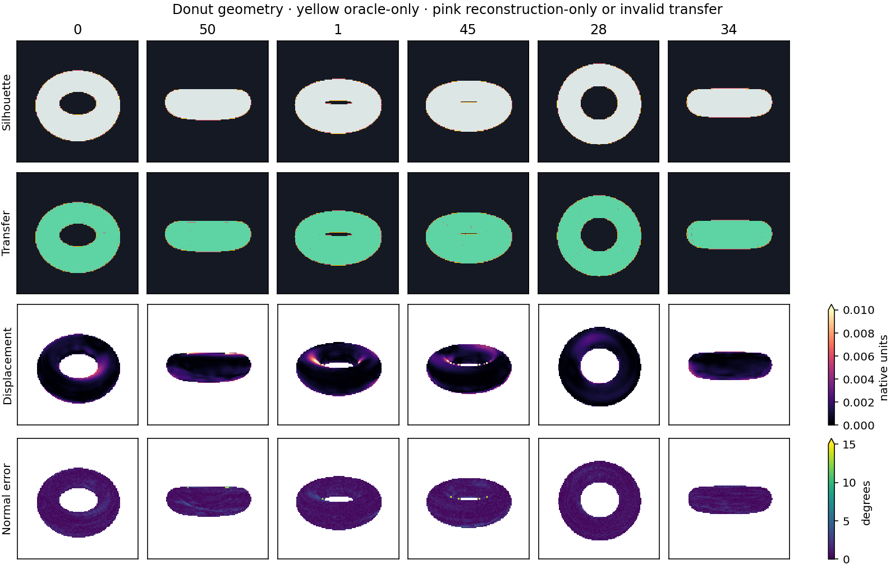

# Publication Gate 2. Full-raster Donut geometry validation

**K1-Dense remains the best overall reconstruction reference.** The accepted three-seed match establishes Final-Ambient as the chart-independent candidate. Compared with Final-Chart, ambient consistently improves Q tails, minor-width error, orientation and held-out RGB. K1-Dense retains the lower Q p95 and errors in both widths at all three seeds. The method decision rests on a single known-light oracle acquisition. [Accepted three-seed results](../bell_publication_seeds_v1/README.md)

**PROCEED to a separately authorized fixed-material RGB comparison.** The historical reconstruction is suitable for a controlled geometry-sensitivity experiment with explicit mask, transfer, and large-depth-shift strata. All mandatory geometry checks passed and 99.74% of common hits have valid evaluation correspondences. A small set of rays hits substantially different surface points. Producing G checkpoint and extraction provenance remain unresolved. [Reviewed protocol](../../protocols/DONUT_RECONSTRUCTED_GEOMETRY_VALIDATION_V1.md) · [Next RGB protocol](../../protocols/DONUT_ORACLE_GEOMETRY_RGB_FLOOR_V1.md)

## Replay, visibility and silhouette

The corrected BVH reproduced all six saved oracle hit masks exactly. Maximum position, depth and interpolated smooth-normal difference from the admitted arrays was zero. All 384 independent FP64 witnesses classified correctly, with 186 hits and 198 misses. No sampled witness needed shared-edge adjudication. Maximum CPU-to-BVH differences were `1.15e-7` in depth, `9.83e-8` in position, and `9.01e-8` in raw-normal components. Maximum raw normal unit-length error was `9.91e-8`.

| Camera or split | Common hits | Oracle only | Reconstruction only | Both miss | Silhouette IoU | Valid common | Valid reconstruction only |
| --- | ---: | ---: | ---: | ---: | ---: | ---: | ---: | ---: |
| 0 | 4,522 | 17 | 1 | 11,844 | .9960 | 4,514 | 1 |
| 50 | 2,625 | 11 | 1 | 13,747 | .9954 | 2,605 | 1 |
| 1 | 4,134 | 14 | 6 | 12,230 | .9952 | 4,131 | 6 |
| 45 | 3,954 | 16 | 5 | 12,409 | .9947 | 3,942 | 5 |
| 28 | 4,838 | 11 | 2 | 11,533 | .9973 | 4,830 | 0 |
| 34 | 2,486 | 11 | 7 | 13,880 | .9928 | 2,478 | 7 |
| Fitting | 15,235 | 58 | 13 | 50,230 | .9954 | 15,192 | 13 |
| Held out | 7,324 | 22 | 9 | 25,413 | .9958 | 7,308 | 7 |
| Pooled | 22,559 | 80 | 22 | 75,643 | .9955 | 22,500 | 20 |

## Displacement and normal errors

Among common hits, the signed reconstruction-minus-oracle depth has median −.000221, p95 +.00201 and range [−.56732, +.42808] native units. Displacement median/p95 is .00069/.00333, and normal-angle median/p95 is .72°/1.93°. Fitting and held-out displacement p95 are .00367 and .00247. Normal error p95 is 2.06° fitting and 1.72° held out. The maximum normal difference is 146.07° on a fitting ray. Held-out maxima are .02490 native units and 9.25°. [Full distributions by camera and split](geometry-metrics.json)

Ten same-pixel depth differences exceed .05 native units, all on fitting cameras. The saved depths show that the first hit can move to a distant part of the surface even when the pixel remains foreground in both meshes. All ten have a grazing view on at least one surface under the frozen cosine criterion. Nine fail transfer because of boundary-side ambiguity, two of those also fail visibility. The exception is camera 1 pixel 8,239, with a −.41649 depth shift and a 110.59° same-ray normal difference. Its projected oracle point is .00199 from the reconstructed hit and passes the separate local correspondence checks. Keep it in its declared validity class and report the large-depth subgroup separately in the RGB comparison. [Large-depth witnesses](depth-outliers.csv)

Across the full raster there are 219 positive-facing oracle grazing hits and 197 reconstructed grazing hits. Nine oracle hits are nonpositive-facing, with zero nonpositive-facing or undefined reconstructed hit normals. The historical mesh retained zero-area face IDs 3538, 3540, 3560 and 4808. Three camera-34 hits are within .005 native units of those degenerate triangles. All three have valid correspondences and finite normals. Proximity does not identify the actual struck triangle. [Witness diagnostics](geometry-witness-summary.json)

## Surface correspondence and physical effects

Transfers are valid for 22,520 of 22,581 reconstructed hits (99.73%). Common-hit coverage is 99.72% fitting and 99.78% held out. Reconstruction-only coverage is 20/22. The 80 oracle-only pixels have no reconstructed surface to label. Of the 61 rejected reconstructed hits, 47 have boundary-side ambiguity and 16 fail oracle visibility, with two overlapping reasons. With the frozen priority, that is 47 boundary-side and 14 visibility exclusions. There are zero missing local candidates, unresolved round trips, invalid reconstructed normals or transferred-normal mismatches. All 22,581 reconstructed hits entered the search, and all had local candidates and reverse searches. Valid-transfer projection distance has median .000462 and p95 .001329. Round-trip displacement p95 is .000061.

All 22,500 valid common transfers contribute to the Q decomposition. Relative Frobenius shift from sampling a different oracle point in a common normal plane has median .000733 and p95 .01138. The frame contribution has median .00818 and p95 .02541, and total shift has median .00891 and p95 .02770. The signed tensor increments add before taking norms. Normal transport preserves both widths to `3.33e-16` maximum absolute error. For the 21,470 common transfers where both labels meet the anisotropy-gap rule, director shift has median .326° and p95 1.075°. This leaves 1,030 valid common transfers outside orientation eligibility and 20 valid reconstruction-only transfers without an original same-ray label. Those observations remain in coverage and width accounting. These are geometry-induced label changes, with no fitted material involved.

## Work and verification

The authorized run exited zero in 24.36 seconds with verified cleanup. Work was 196,608 primary rays, 22,578 extra visibility rays (three coincident visibility queries reused the primary), 384 FP64 witnesses, 45,162 nearest searches and 1,000,663 exact projection candidates. Peak host RSS was 4.62 GiB and peak Torch CUDA allocation was .8125 MiB. The committed verifier checked all 18 native artifact hashes, recomputed camera and split statistics and verified the transfer and Q identities. There were zero renderer calls, checkpoint loads or optimizer updates. [Artifact manifest](artifact-manifest.json) · [Preliminary audit kept unchanged](../publication_gate1/donut-geometry-readiness-v1.json)

## Remaining publication checks

1. **Cross-geometry representation check.** Use a new same-recipe chart/ambient comparison on a second admitted geometry. Carry the orientation benefit and the width and boundary limitations forward as separate outcomes.
2. **Reconstructed-geometry material recovery.** Next measure the geometry-induced RGB floor with fixed oracle material and recomputed visibility. Use a later matched recovery pair to measure how that floor changes physical recovery. [Proposed RGB protocol](../../protocols/DONUT_ORACLE_GEOMETRY_RGB_FLOOR_V1.md)
3. **Unseen-illumination relighting.** Evaluate fixed recovered materials with an independent unseen-light reference, shared linear radiometry, and explicit common-foreground and full-raster errors.
4. **External baseline.** Match observations, masks, and compute accounting. Document the baseline BRDF family and any comparability limits for material-space metrics.
