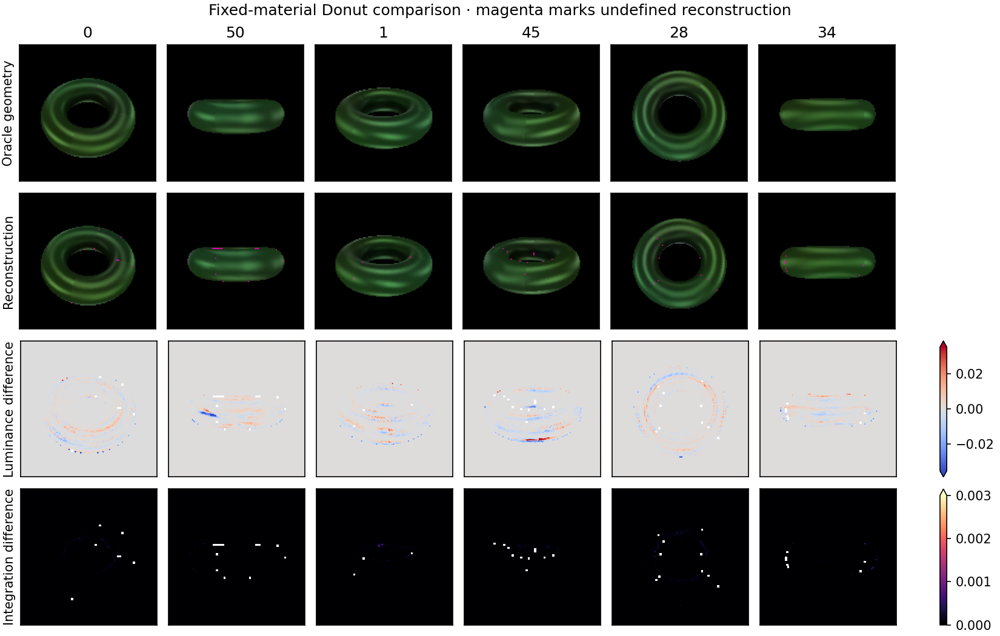

# Publication Gate 3. Fixed-material Donut RGB discrepancy

**PROCEED to a separately approved, matched material-recovery sensitivity test.** The reconstructed Donut has sufficient verified common support for the test. The fixed-material RGB discrepancy is measurable, predominantly evident in the specular component relative to its own signal, and spatially concentrated near grazing views and boundaries. It reflects the combined effects of surface position, normal frame, visibility and sampling the same analytic material field at different surface points. The geometry's producing NeuS checkpoint and extraction provenance remain unresolved. [Frozen rendering protocol](../../protocols/DONUT_ORACLE_GEOMETRY_RGB_FLOOR_V1.md) · [Gate 2 geometry results](../publication_gate2/README.md) · [Proposed matched recovery](../../protocols/DONUT_MATCHED_GEOMETRY_RECOVERY_PROPOSAL_V1.md)

## Linear RGB by camera and split

RGB, diffuse and specular columns are relative L2 on common hits with defined reconstruction radiance. The raster column includes known misses as zero and measures only pixels with defined radiance on both sides. All component metrics use their own oracle denominator. Signed luminance, absolute RMSE, exact masks and numerical uncertainty by cohort are in the [numeric results](rgb-metrics.json).

| Camera or split | Defined common hits | Undefined raster pixels | Common RGB | Common diffuse | Common specular | Known-support raster RGB |
| --- | ---: | ---: | ---: | ---: | ---: | ---: |
| 0 | 4,514 | 8 | 5.88% | 2.40% | 7.42% | 8.71% |
| 50 | 2,605 | 20 | 7.70% | 0.55% | 11.16% | 8.12% |
| 1 | 4,131 | 3 | 6.04% | 0.62% | 8.24% | 6.78% |
| 45 | 3,942 | 12 | 10.85% | 0.64% | 14.24% | 11.36% |
| 28 | 4,830 | 10 | 5.79% | 0.56% | 7.57% | 6.42% |
| 34 | 2,478 | 8 | 5.00% | 1.82% | 7.24% | 6.30% |
| Fitting | 15,192 | 43 | 7.80% | 1.22% | 10.49% | 8.86% |
| Held out | 7,308 | 18 | 5.54% | 1.27% | 7.48% | 6.38% |
| Pooled | 22,500 | 61 | **7.12%** | **1.24%** | **9.58%** | **8.11%** |

Pooled common-support RGB RMSE is .00343 linear units and signed luminance is +.000084 (reconstruction minus oracle). The raster-support RMSE is .00187. Of 98,304 raster pixels, 98,243 are defined. The 61 undefined pixels contain 0.2435% of the full oracle RGB squared energy. Charging measured squared error against the full oracle squared-energy denominator gives a **.00655 squared relative-error lower bound** for this fixed-material comparison. A complete full-raster score would require radiance at the undefined pixels.

| Cohort | Defined / total | Common or cohort RGB relative L2 | Share of measured raster RGB squared error |
| --- | ---: | ---: | ---: |
| Common foreground | 22,500 / 22,559 | 7.12% | 76.97% |
| Oracle only | 80 / 80 | 100% | 19.92% |
| Reconstruction only | 20 / 22 | Oracle denominator zero | 3.11% |
| Boundary band or ambiguous side | 2,650 / 2,698 | 10.47% | 17.62% |
| Grazing on either mesh | 289 / 305 | 54.94% | 24.11% |
| Degenerate-adjacent | 3 / 3 | 0.90% | <0.001% |
| Large same-ray depth shift | 1 / 10 | 45.54% on the defined pixel | 0.0047% |

The oracle-only and reconstruction-only RMSEs are .02927 and .02314, respectively. True misses on both meshes contribute zero. Boundary, grazing, degenerate-adjacent and depth-shift cohorts can overlap. All ten large-depth-shift classifications are retained. The defined case, camera 1 pixel 8,239, contributes `4.83e-5` RGB squared error. The other nine retain their oracle RGB and undefined reconstruction radiance. They account for 97.73% of the oracle squared energy within that ten-pixel cohort. [Ten preserved depth cases](depth-outlier-rgb.csv)

## Numerical convergence and evidence

All 12 camera/mesh integrations passed the unchanged absolute .003 and relative .002 RGB convergence gates. The largest final channel change across views was .001146 and the largest relative change was .001145. Camera 50 pixel 7,317 was the only paired refinement. Independently traced oracle radiance then matched the admitted fine RGB arrays exactly on all six cameras. The pooled common-support coarse-to-fine change of the **between-mesh difference** is `2.05e-5` RGB RMSE, 0.60% of the measured discrepancy L2 norm. It is 0.52% on fitting and 0.83% on held-out common support. This comparison quantifies the resolved numerical change between the chosen grids. It does not establish absolute quadrature accuracy.

The run exited zero in 510.89 seconds on the reviewed A100 with verified cleanup. It used 14,805,237,760 incident shadow queries and the same number of independent BRDF point-directions, below the 16,136,929,280 ceilings. Host peak RSS was 4.73 GiB and peak Torch CUDA allocation was 18.76 MiB. The committed verifier replayed the refinement decisions and verified all 28 capture hashes. No previews clipped, and no new primary rays, checkpoint loads, native model calls or optimizer updates occurred. [Provenance and artifact hashes](artifact-manifest.json)

## Recovery decision

Proceed to the proposed geometry-only comparison within each accepted estimator recipe. Keep K1 as the reconstruction reference and ambient as the chart-independent candidate. The same observed oracle RGB must be used for both geometries in each matched pair. A subsequent fit can compensate for geometry with biased material estimates, so report RGB and physical recovery separately. The measured discrepancy characterizes fixed oracle material under this acquisition. It does not bound the RGB error attainable by inverse rendering. [Bounded matched-recovery proposal](../../protocols/DONUT_MATCHED_GEOMETRY_RECOVERY_PROPOSAL_V1.md)
