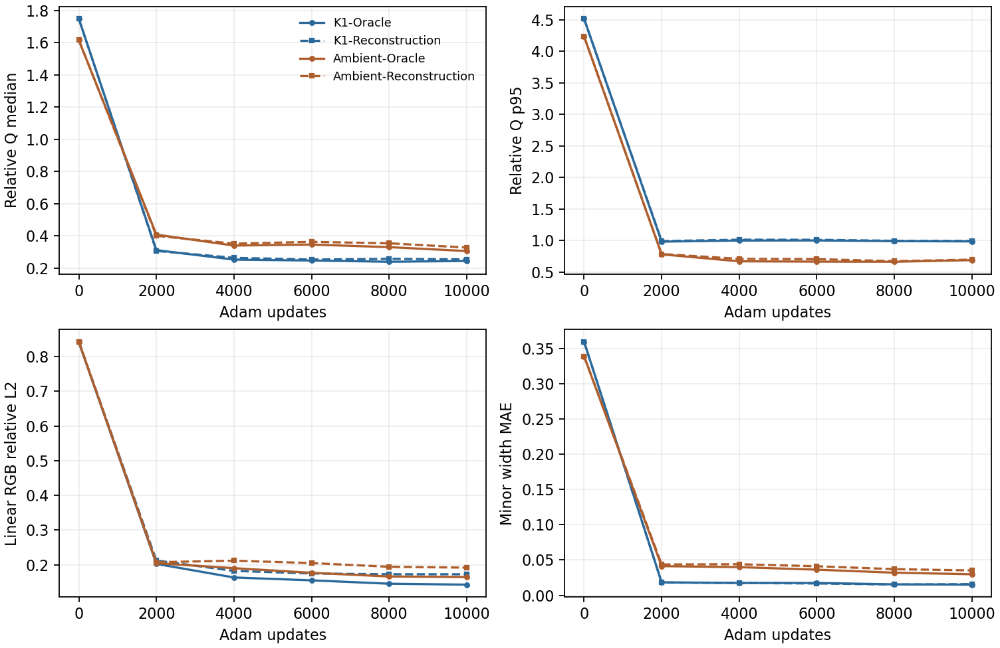
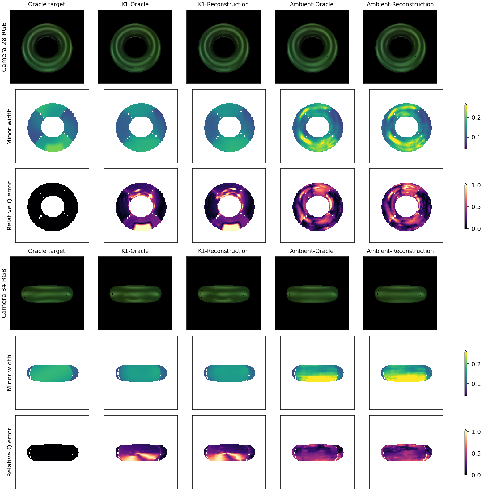

# Publication Gate 4. Matched Donut recovery across geometries

**Both reconstructed-geometry fits partially compensated for geometry in the fitting images and recovered less accurate physical materials.** K1 and ambient reduced fitting RGB error below the fixed-material discrepancy on the same reconstructed mesh. Each also returned higher median and p95 Q error than its matched oracle-geometry fit. Held-out RGB error increased for both recipes. The compensation therefore appears in the fitting views and does not generalize to the two held-out views. [Frozen protocol](../../protocols/DONUT_MATCHED_GEOMETRY_RECOVERY_V1.md) · [Fixed-material Gate 3 comparison](../publication_gate3/README.md)

## Fixed 10,000-update endpoints

All histories used the same 15,191 fitting and 7,306 held-out observations, original oracle RGB, fixed analytic L2, zero indirect, and the same recorded fitting-index stream. Relative Q errors use the archived physical labels for each geometry. The reconstruction labels use the unchanged oracle field and verified normal transport. [Endpoints, widths, signed biases and scalar errors](endpoints.csv) · [Reconstruction-minus-oracle deltas](paired-deltas.csv)

| Recipe and geometry | Fitting RGB L2 | Fitting Q median / p95 | Held-out RGB L2 | Held-out Q median / p95 | Held-out major / minor MAE |
| --- | ---: | ---: | ---: | ---: | ---: |
| K1 oracle | 4.97% | .1978 / 1.0982 | 14.30% | .2441 / .9839 | .04654 / .01502 |
| K1 reconstruction | 6.05% | .2089 / 1.1619 | 17.30% | .2542 / .9922 | .04603 / .01583 |
| Ambient oracle | 5.18% | .2457 / .6531 | 16.49% | .3057 / .6866 | .04549 / .02981 |
| Ambient reconstruction | 6.57% | .2808 / .6795 | 19.20% | .3275 / .6953 | .04881 / .03521 |
| Fixed-material reconstruction, Gate 3 on exact Gate 4 support | 7.74% | — | 5.51% | — | — |

Relative to the fixed-material reconstruction, K1 reduces fitting RGB L2 by **1.69 percentage points** (21.8%) and ambient by **1.17 points** (15.2%). Relative to their own oracle-geometry fits, the reconstructed fits have fitting Q median increases of .0111 and .0351, respectively. Held-out RGB increases by 2.99 and 2.71 points, and held-out Q medians increase by .0101 and .0218. Oracle-geometry fits still lead each pair in pooled fitting and held-out RGB. The fitting result is consistent with material compensation at fixed geometry and illumination. Per-parameter attribution remains unresolved. The oracle-geometry held-out errors show how much error already exists before replacing the mesh. The Gate 3 discrepancy describes fixed oracle material under the tested acquisition.

### Physical shifts and boundary recovery

- **K1.** Held-out major-width MAE decreases slightly (−.00051), while minor-width MAE increases by .00081. Signed major/minor biases change from −.02581/−.00994 to −.02332/−.01054. Max-channel albedo and metallic MAEs rise by .00208 and .00088. On 7,065 commonly eligible held-out observations, orientation p95 rises from 59.11° to 59.87°.
- **Ambient.** Held-out major and minor width MAEs increase by .00331 and .00540. Signed biases change from −.01719/+.01733 to −.01418/+.02478. Albedo and metallic MAEs rise by .00256 and .00055. On 6,898 commonly eligible held-out observations, orientation p95 falls from 28.80° to 28.06°. That orientation gain coexists with worse widths and Q. Each recipe's own orientation eligibility and common-subset denominators are archived.
- **Common frame.** Fresh weights and buffers matched exactly within each geometry pair. At initialization the median held-out Q shift between model predictions, after transporting to the oracle tangent plane and normalizing by oracle Q, was .000386 for K1 and .001528 for ambient. These became .06410 and .09849 at 10,000 updates. Initial median max-channel base-color shift was `3.52e-6` for both recipes. These are paired prediction changes at matching rays. Gate 2 separately measures the fixed-label sampling and frame shifts, which should remain separate from changes in the trained predictions. [Gate 2 Q decomposition](../publication_gate2/README.md) · [Initialization, common-frame and trajectory metrics](matched-results.json)

On the 60 fitting and 22 held-out boundary-neighbor pairs, all recipes substantially attenuate the true width step. On camera 28 (17 pairs), the median projected Q-jump fraction falls from 5.79% to 4.60% for K1 and from 10.48% to 7.47% for ambient. On camera 34 (five pairs), K1 increases from 12.82% to 14.15% and ambient falls from 34.99% to 30.26%. Against a major-width step near .120, camera 28's mean signed prediction falls from .00733 to .00680 for K1 and from .01968 to .01303 for ambient. The results describe the prescribed pixel-pair subset. [Per-camera jumps and both signed widths](boundary-jumps.csv)

### Coverage and difficult cases

The common observation pool retains 22,497 of 22,559 common geometry hits. Fifty-nine common hits fail the Gate 2 transfer conditions, and three more are below the oracle shading horizon. The 80 oracle-only pixels, 22 reconstruction-only pixels and 75,643 shared misses remain separately accounted for. Of the 61 reconstruction hits with undefined transfer, 47 have boundary-side ambiguity and 16 visibility failure, with two overlapping. The transfer-invalid pixels remain excluded from all four fitting/evaluation pools. The three degenerate-adjacent hits are included and have their own held-out cohort. Producing NeuS checkpoint and extraction provenance for the historical mesh remain unresolved.

On 128 fitting grazing observations, K1 RGB L2 rises from 6.93% to 8.98% and ambient from 6.05% to 10.76% with the reconstructed geometry. On 70 held-out grazing observations, the increases are 13.93% to 19.21% and 13.99% to 19.02%. The 854 held-out boundary-band points have median Q increases from .3004 to .3188 for K1 and .3209 to .3436 for ambient. Camera 1 pixel 8,239 remains the only large-depth-shift pixel in the matched pool. Its RGB error grows in both reconstructed fits while its local physical Q error falls. The other nine remain outside the pool with their invalidity reasons preserved. [All cohort and per-camera metrics](matched-results.json) · [Gate 3 depth cases](../publication_gate3/depth-outlier-rgb.csv) · [Full coverage archive identity](artifact-manifest.json)

## Controls, work and publication decision

All four histories exited zero with verified cleanup and completed **40,000 total Adam returns**, 49,156 shader calls and 38,096,781,312 shadow-ray slots. The verifier checked **3,568 recorded native artifacts**, fixed-light routing and zero illumination updates, the 24-point independent Gate 3 compatibility controls, the accepted initial weights, the LR stream, and the byte-identical 5,120,000 fitting indices per history. The native trainer performed five own-checkpoint roundtrips per history. Offline verification read the six saved evaluation states without rendering or loading checkpoints. Native compatibility pooled relative L2 was 0.87–1.21% across the four gates, with zero failing components. Eight-draw endpoint standard-error RMS ranged from .00059 to .00071 across cameras and arms. Native runtimes were 839/856 seconds for K1 and 825/863 seconds for ambient, oracle/reconstruction respectively. [Receipts, checkpoint hashes, stream and packaged assets](artifact-manifest.json)

Keep K1-Dense as the accepted reconstruction reference and ambient as the chart-independent representation candidate. On Donut, K1 has lower median Q and RGB error, and ambient has lower Q p95 and better orientation tails. The two recipes differ in initialization, priors and rendering, so Gate 4 identifies the matched geometry effect within each recipe. It cannot isolate a representation effect across recipes or establish authenticated G→A provenance.

For the next cross-object representation check, use the already completed Ambient-Oracle history and add a separately approved Final-Chart history on the exact Gate 4 oracle observation pool. Match the weak physical start, tensor evaluator, proposals, known lighting, objectives and index stream. That is the smallest comparison that tests whether the Dense Bell matched advantage generalizes to Donut. Follow with independent unseen-light relighting at fixed radiometry and one external baseline on matched observations, masks and compute. No new scientific execution was started in this analysis.
