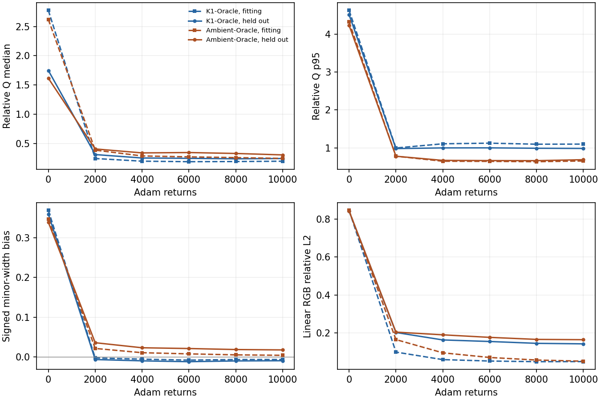

# Publication Gate 5 — Donut diagnostic and matched-chart readiness

**Completed analysis.** [Gate 5 results and verified execution](RESULTS.md)

**Decision: PROCEED to separate execution authorization.** The archived Ambient-Oracle history is a valid comparator for one new Final-Chart-Oracle history on the exact Gate 4 oracle observation pool. No Donut representation result exists yet. The prior K1 comparison tests a broader recipe. [Frozen protocol](../../protocols/DONUT_REPRESENTATION_GATE5_V1.md)

## What the saved oracle histories show

These are step-10,000 observations with 15,191 fitting rows and 7,306 held-out rows. Width units are the original Beckmann widths. Bias is predicted minus oracle. RGB is relative linear-RGB L2.

| History | Split | Relative Q median / p95 | Major / minor width MAE | Major / minor signed bias | RGB |
|---|---|---:|---:|---:|---:|
| K1-Oracle | Fitting | 0.198 / 1.098 | 0.0400 / 0.0126 | −0.0101 / −0.0069 | 0.0497 |
| Ambient-Oracle | Fitting | 0.246 / 0.653 | 0.0428 / 0.0192 | −0.0156 / +0.0038 | 0.0518 |
| K1-Oracle | Held out | 0.244 / 0.984 | 0.0465 / 0.0150 | −0.0258 / −0.0099 | 0.1430 |
| Ambient-Oracle | Held out | 0.306 / 0.687 | 0.0455 / 0.0298 | −0.0172 / +0.0173 | 0.1649 |

- **Minor-width bias has a positive tail in Ambient-Oracle.** Its held-out minor-width errors have median +0.0053 and 5th/95th percentiles −0.0298/+0.1140. K1's corresponding values are −0.0094 and −0.0339/+0.0153. No sorted width meets the existing floor or ceiling saturation cutoffs at either endpoint. Under the two recipes, held-out albedo maximum-channel MAE is 0.0344 for Ambient and 0.0284 for K1. Metallic MAE is 0.0445 and 0.0406, respectively.
- **Orientation has a median–tail tradeoff.** Of 7,306 held-out rows, 6,962 are orientation-eligible in both predictions. On these rows the Ambient/K1 medians are 6.15°/2.99° and p95s are 29.54°/59.00°. On region 0 the per-arm p95s are 32.29°/67.87°, compared with 18.06°/23.88° on region 1. The 241 near-isotropic held-out observations are ineligible for orientation in both methods. Their median relative Q errors are 0.165 for Ambient and 1.129 for K1. These observations remain in all applicable physical and RGB metrics.
- **Both fields attenuate jumps.** Across the 852 held-out near-boundary observations, major/minor MAEs are 0.0522/0.0339 for Ambient and 0.0491/0.0204 for K1. The 17 fixed camera-28 crossing pairs show a mean oracle jump of 0.1202/0.0579, versus predictions of 0.0197/0.0111 and 0.0073/0.0071. On those pairs, the median projection of predicted Q jump onto oracle Q jump is 0.105 and 0.058, respectively. Five valid camera-34 pairs have the same qualitative attenuation.
- **Coverage is associated with the held-out gap.** For 765 of 7,306 held-out rows the frozen spatial and normal criterion finds no nearby fitting observation. Ambient minor-width MAE is 0.0906 there and 0.0227 on the 6,541 covered rows. Its MAE is 0.0181 when a nearby fitting highlight exists, 0.0263 with nearby fitting coverage but no nearby fitting highlight, and 0.0374 across all rows lacking a nearby fitting highlight. For Ambient, camera 34 has minor-width MAE 0.0426 and RGB error 0.1528. Camera 28 has minor-width MAE 0.0232 and RGB error 0.1708. For K1 the respective camera-34 and camera-28 pairs are 0.0201/0.1893 and 0.0124/0.1118. The coverage proxy uses the existing 0.01-native-unit lookup and a 30° normal cutoff. It does not measure observability directly.
- **Grazing alone does not explain the result.** The 70 held-out grazing rows have smaller median Q errors than the 7,236 non-grazing rows in both methods (Ambient 0.227 vs 0.307, K1 0.154 vs 0.245). Their orientation tails are worse (Ambient p95 38.92° vs 29.47°, K1 64.89° vs 58.91°). The small cohort is reported without generalizing beyond these rows.

[Full signed distributions, camera and cohort scores, and boundary jumps](gate4-oracle-diagnostics.json)

Ambient's held-out Q median improves from 0.408 at 2,000 to 0.306 at 10,000. Its last 2,000 updates improve that median and RGB while the Q p95 rises from 0.661 to 0.687. K1 improves sharply early, then its fitting median Q rises from 0.190 at 6,000 to 0.198 at 10,000 as held-out RGB continues to improve. The saved finite gradient and loss traces provide no evidence of a numerical stoppage. They do not establish whether longer optimization could improve the tails.

The boundary attenuation documents a field that smooths the measured jump. Its cause could include the predictor, photometric objective, limited local observation diversity or optimization. Coverage and highlight association support an acquisition limitation as a hypothesis, but the strata differ in geometry and material composition. Physical errors persist with oracle geometry and known light. Gate 4 additionally reports higher held-out RGB error on the historical reconstruction for both recipes (K1 0.1730, Ambient 0.1920). Neither observation identifies a cause for the residual oracle error. [Accepted geometry comparison](../publication_gate4/README.md)

## Match and remaining limits

Offline analysis verified both archived oracle receipts and output hashes, replayed their independent numerical admission from saved arrays, checked the full learning-rate streams and recomputed the physical scores on the same support. It ran zero renderer calls, checkpoint deserializations or optimizer updates. Ambient-Oracle completed 10,000 returns in 825 seconds with verified cleanup. Its archived 24-point chart/ambient initialization gate reported world-Q max difference 2.22e-16, exact scalar fields and exact paired RGB. The new arm inherits that trainer byte for byte. The launcher binds and the native admission replays the accepted arrays, including the shared-tape BRDF and PDF checks. It will stop before any update if required parity fails.

Donut tests one seed, one material field and one acquisition. Head width differs by two outputs, accounting for 516 trainable parameters, so the matched experiment measures the representation and its associated parameterization together. It does not separate the effect of parameter count. K1 also differs in physical initialization, sampling and prior implementation. Donut results will complement the three-seed Bell comparison and cannot establish a universal advantage over K1. Native chart parity, runtime and completion remain unmeasured.

Preparation checks passed for all 14 focused CPU cases, Bash syntax, freeze reconstruction, capture identity replay and read-only admission of the original six cameras. The checked benchmark and fitting stream are bound to the new source. Docker image inspection from this session was denied by the daemon socket permissions. The authorized launcher requires the image ID to match on the execution host.
