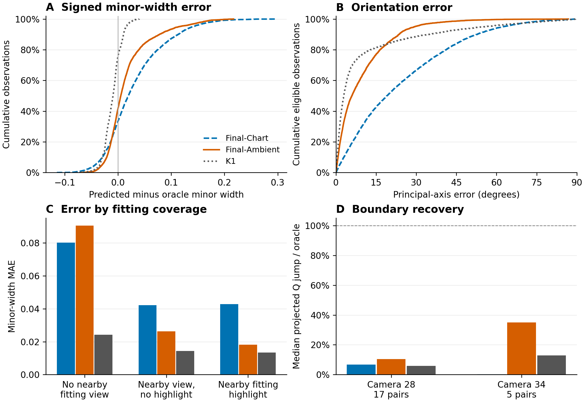
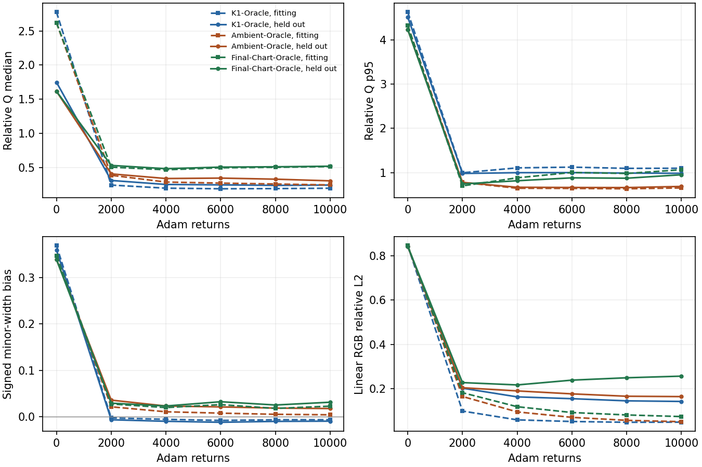

# Publication Gate 5 — Matched chart and ambient prediction on Donut

**PROCEED with ambient tensor prediction as the matched representation result. Retain K1 as the overall reconstruction reference.** On the frozen Donut acquisition, Final-Ambient improves on Final-Chart in the same held-out measures that favored it across all three Bell seeds: relative Q median and p95, minor-width MAE, principal-axis error, and linear-RGB error. K1 retains better median Q, minor-width accuracy, and RGB on Donut. [Protocol](../../protocols/DONUT_REPRESENTATION_GATE5_V1.md) · [Three-seed Bell results](../bell_publication_seeds_v1/README.md)

## Frozen 10,000-update endpoints

All histories used the same 15,191 fitting and 7,306 held-out observations and the same index stream. The chart and ambient pair also used the same weak physical start, tensor renderer, sampling tapes, objective and optimizer. K1 differs in initialization, sampling path and prior implementation, so its comparison is between complete recipes. RGB is relative L2 in linear space. Width bias is prediction minus oracle.

| Method | Split | Relative Q median / p95 | Major / minor width MAE | Major / minor width bias | RGB L2 |
| --- | --- | ---: | ---: | ---: | ---: |
| Final-Chart | Fitting | .5142 / 1.0640 | .05551 / .03966 | −.02569 / +.02242 | .07482 |
| Final-Ambient | Fitting | .2457 / .6531 | .04280 / .01919 | −.01561 / +.00376 | .05184 |
| K1 | Fitting | .1978 / 1.0982 | .04002 / .01261 | −.01007 / −.00687 | .04972 |
| Final-Chart | Held out | .5199 / .9510 | .05835 / .04639 | −.03238 / +.03094 | .25707 |
| Final-Ambient | Held out | .3057 / .6866 | .04549 / .02981 | −.01719 / +.01733 | .16489 |
| K1 | Held out | .2441 / .9839 | .04654 / .01502 | −.02581 / −.00994 | .14302 |

Ambient cuts held-out median Q by **41.2%**, Q p95 by **27.8%**, major/minor width MAE by **22.0%/35.8%**, and RGB error by **35.9%** relative to chart. Held-out albedo maximum-channel MAE is .05216/.03442/.02838 and metallic MAE is .04708/.04451/.04063 for Chart/Ambient/K1. The numbers of held-out observations with relative Q error at most .05 are 62/207/457. All three endpoints have zero sorted-width saturation counts under the frozen cutoffs. [All endpoint and trajectory metrics](results-v1/trajectory-endpoints.csv)

| Held-out orientation subset | Rows | Final-Chart median / p95 | Final-Ambient median / p95 | K1 median / p95 |
| --- | ---: | ---: | ---: | ---: |
| Chart and Ambient common | 6,478 | 19.03° / 62.25° | 5.95° / 29.38° | — |
| Ambient and K1 common | 6,962 | — | 6.15° / 29.54° | 2.99° / 59.00° |
| All three common | 6,478 | 19.03° / 62.25° | 5.95° / 29.38° | 2.91° / 55.65° |

Chart, Ambient and K1 individually have 6,553, 6,962 and 7,065 eligible held-out observations. Ambient adds 409 eligible rows relative to chart. In fitting views, the matched orientation p95 is 60.50° for chart and 25.11° for ambient on 13,474 common rows.

## Error distributions and difficult regions

- **Minor-width positive tail.** Held-out median signed error is +.01965/+.00533/−.00936, and the signed p95 is +.14108/+.11402/+.01533 for Chart/Ambient/K1. Ambient reduces the chart tail, while the residual overestimation remains material.
- **Near isotropy.** On 241 held-out near-isotropic observations, relative Q median/p95 is .206/.518 for Chart, .165/.536 for Ambient and 1.129/1.203 for K1. Ambient improves the chart median and minor-width MAE (.00960 vs. .01609), with a slightly higher Q p95. These rows are ineligible for orientation for all three methods and remain in physical and RGB metrics.
- **Coverage.** On 765 held-out rows with no nearby fitting view, minor-width MAE is .08009/.09055/.02428 for Chart/Ambient/K1. On the 6,541 rows with nearby fitting coverage the values are .04245/.02270/.01394. Ambient gains strongly in the covered strata, which include 2,877 rows with a nearby fitting highlight. Its median Q also improves over Chart on uncovered rows (.451 vs. .531), despite the higher minor-width error. The geometry-based proxy identifies nearby observations using the frozen distance and normal rule. Stronger local constraints are a possible explanation for the association.
- **Boundaries.** Held-out boundary-band Q median is .588/.321/.300 and smooth-interior Q median is .522/.311/.225 for Chart/Ambient/K1. On camera 28's 17 fixed crossing pairs, projected median Q jump recovery is 6.76%/10.48%/5.79%. On camera 34's five pairs it is 0.27%/34.99%/12.82%. Camera 28's mean signed major/minor jumps are .01894/.00990, .01968/.01112 and .00733/.00707 against .12016/.05793 oracle. Both tensor predictors substantially attenuate the width discontinuity. The camera 34 comparison has a small denominator.
- **Per camera.** Final-Chart's held-out RGB errors are .2456/.2779 on cameras 28/34, compared with .1708/.1528 for Ambient and .1118/.1893 for K1. Ambient improves on Chart in both cameras, while the K1 versus Ambient ordering varies by camera. [Full signed distributions, region, grazing and camera scores](results-v1/representation-results.json) · [Vector figure](results-v1/held-out-physical-comparison.pdf)

## Trajectories and interpretation

Chart and Ambient start with identical RGB and scalar predictions. Ambient leads held-out median Q and RGB by the first saved trained state at 2,000 updates. Its minor-width MAE first leads at the 6,000-update capture. Between 4,000 and 10,000, chart fitting RGB improves from .1193 to .0748 while held-out RGB rises from .2175 to .2571 and held-out Q median rises from .484 to .520. Ambient's held-out RGB falls from .1905 to .1649 over that interval. The prescribed endpoint remains 10,000 for all comparisons.

The shared evaluator, samples, and data support an effect of the representation and its associated predictor parameterization under this recipe. Both matched runs have similar runtimes and finite gradients. The results do not isolate chart seams, field capacity or optimization as mechanisms. The Donut result uses one seed on one particular known-light acquisition. Together with Bell, it supports generalization of the matched advantage across these tested objects. Boundary attenuation and uncovered-region minor-width error remain limitations, and the 516-parameter difference is part of the comparison.

## Verification and next step

The single new chart history exited zero, completed exactly **10,000 Adam returns** in **826.9 seconds** on the frozen A100 image, and passed cleanup. It recorded 12,290 shader calls, 9,524,232,192 shadow-ray slots, 30 component reverse sweeps, two tensor predictor probes and two tensor diagnostic reverse sweeps. No learned-light calls or updates occurred. Native parity replay had zero difference across every saved admission field. Full-raster initialization replay measured maximum Q difference 2.78e-16 and exact scalar and RGB predictions. The independent known-light gate had zero failing components. Offline analysis verified 893 new native artifacts and 1,784 archived comparator artifacts, replayed the 5,120,000 fitting indices, and rescored all six saved states per history. No history was rerun, and offline work used zero renderer calls, checkpoint deserializations and optimizer updates. Ambient ran in 825.1 seconds. [Authorization, receipts and artifact identities](results-v1/artifact-manifest.json)

The next separately authorized comparison should freeze the existing three Donut checkpoints and test one unseen known illumination on the same two held-out cameras against independent linear references. Fixed geometry, visibility, exposure and support would test whether the observed physical gains improve relighting. Retain K1 for absolute reconstruction and carry the matched chart/ambient pair into that evaluation.
