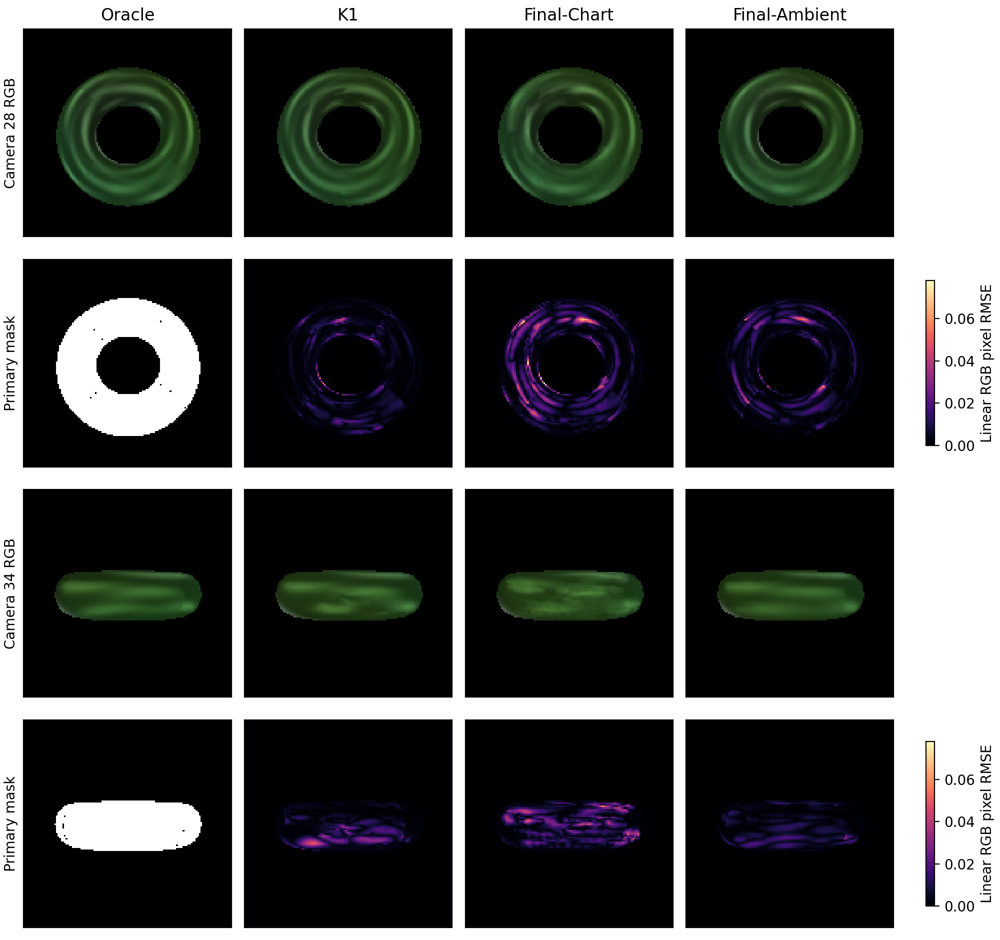

# Publication Gate 6 — Donut relighting under unseen illumination

**PROCEED.** Final-Ambient improves on its matched Final-Chart control under the unseen rotated L2 light, in both cameras and through both evaluation paths. K1 and Final-Ambient are both project methods. K1 has a small pooled RGB advantage and leads on camera 28. Final-Ambient leads on camera 34 and on near-isotropic and poorly covered observations. [V2 protocol](../../protocols/DONUT_RELIGHTING_GATE6_V2.md) · [Gate 5 material recovery](../publication_gate5/RESULTS.md)

## Frozen checkpoint results

The primary comparison integrates each recovered step-10,000 material field using the same independent FP64 Kurt/Beckmann renderer, fixed oracle geometry, direct light and visibility. The secondary path renders the same materials using each method's native estimator and 32 draws. Chart and Ambient share their training recipe and renderer. K1's comparison includes its different initialization, sampler and training recipe.

| Method | Independent RGB L2 | Independent RGB RMSE | Independent unit-peak PSNR | Native RGB L2 | Independent diffuse / specular L2 |
| --- | ---: | ---: | ---: | ---: | ---: |
| K1 | .15476 | .007551 | 42.44 dB | .15490 | .11938 / .22223 |
| Final-Chart | .26176 | .012771 | 37.88 dB | .26209 | .12929 / .36573 |
| Final-Ambient | .15671 | .007646 | 42.33 dB | .15672 | .11938 / .22454 |

All table entries use the **7,306 primary common foreground pixels**. Ambient lowers independent total RGB error by **40.1%** and specular error by **38.6%** relative to Chart. Diffuse L2 decreases by 7.7%. K1's pooled RGB L2 is .00195 lower than Ambient's. The camera rankings show the tradeoff.

| Camera | Common pixels | K1 independent / native | Final-Chart independent / native | Final-Ambient independent / native |
| --- | ---: | ---: | ---: | ---: |
| 28 | 4,830 | .12378 / .12427 | .25842 / .25848 | .16944 / .16951 |
| 34 | 2,476 | .19971 / .19947 | .26781 / .26865 | .12999 / .12984 |

The expanded foreground contains 7,344 positive-facing pixels, including 38 outside the Gate 5 common support. The full raster contains 32,768 pixels, including 25,422 known black background pixels and two below-horizon black hits, with zero undefined pixels. Independent RGB L2 on the 38 extra pixels is .09025/.27985/.12931 for K1/Chart/Ambient. Expanded foreground and full raster have the same relative L2 (.15453/.26184/.15660). Full-raster RMSE is .003568/.006047/.003616 and unit-peak PSNR is 48.95/44.37/48.83 dB. The known black pixels lower full-raster RMSE through its denominator. PSNR uses a fixed unit peak in linear radiance. The previews use standard sRGB at unit exposure with zero clipped channels and one common error scale. [All cameras, scopes, components and both routes](results-v2/relighting-metrics.csv)

[Independent figure PDF](results-v2/independent-relighting.pdf) · [Native figure PDF](results-v2/native-relighting.pdf) · [Native previews and error maps](results-v2/native-relighting.png)

## Cohorts and physical error associations

| Common-support cohort | Pixels | K1 RGB L2 | Final-Chart RGB L2 | Final-Ambient RGB L2 |
| --- | ---: | ---: | ---: | ---: |
| Region 0 | 4,574 | .18320 | .26702 | .17168 |
| Region 1 | 2,732 | .09659 | .25353 | .13070 |
| Near-isotropic | 241 | .19913 | .09410 | .07301 |
| Boundary band | 852 | .15451 | .33720 | .20286 |
| Grazing using the oracle view cosine | 51 | .17537 | .18199 | .13909 |
| Unseen-light highlight | 1,140 | .11470 | .22478 | .14908 |
| Unseen-light non-highlight | 6,166 | .18854 | .29638 | .16452 |
| Fitting-light highlight | 1,639 | .13176 | .25253 | .17590 |
| No nearby fitting view | 765 | .32261 | .19583 | .18351 |
| Nearby fitting view, no nearby fitting highlight | 3,664 | .14407 | .27962 | .17011 |
| Nearby fitting highlight | 2,877 | .09975 | .25443 | .13377 |

These are the independent RGB scores. Ambient's lower boundary-band RGB error compared with Chart coexists with the width-jump attenuation measured in Gate 5. K1 better reproduces boundary-band and strong-highlight RGB under this light. The unseen-light highlight cohort has higher absolute RGB RMSE than its complement for each method, with lower relative L2 because the reference is brighter. The 765 uncovered pixels cluster in camera 34, which accounts for 752 of them. Their scores associate coverage and relighting error with the tested view and material distribution. [Both route and component cohort scores](results-v2/relighting-results.json)

| Prior physical error vs. independent RGB error | K1 28 / 34 | Final-Chart 28 / 34 | Final-Ambient 28 / 34 |
| --- | ---: | ---: | ---: |
| Relative Q | .420 / .632 | .375 / .280 | .405 / .377 |
| Major width | .345 / .461 | .174 / .187 | .313 / .077 |
| Minor width | .250 / .132 | .265 / .136 | .225 / .382 |
| Orientation | .301 / .574 | .399 / .263 | .306 / .419 |

The entries are per-camera Spearman coefficients. Orientation uses each method's frozen eligibility mask. The eligible counts on cameras 28/34 are 4,589/2,476 for K1, 4,354/2,199 for Chart, and 4,532/2,430 for Ambient. The shared independent evaluator supports a recovered-material explanation for the matched chart/ambient difference. The correlations do not attribute it to one parameter. Base color, metallicity, roughness and orientation vary together, and the association varies by view. [All physical associations and denominators](results-v2/physical-associations.csv)

## Numerical uncertainty and verification

All eight camera/field checks pass the frozen .003 absolute and .002 pooled-relative RGB convergence limits. Camera 28 used baseline grids only. Camera 34 refined pixels 9,366, 8,467 and 9,624 for every field. The largest accepted absolute grid difference was .002461, and the largest relative L2 change was .001125, both for Chart on camera 34. Pooled common-support changes in the paired RGB residual between grids have RMS 8.74e-6, 3.37e-5 and 1.21e-5 for K1/Chart/Ambient. The primary rankings agree at both grid resolutions. These are observed convergence differences between grids. [Convergence table](results-v2/convergence.csv)

On the common support, pooled native-minus-independent RGB RMSE is .000428/.000471/.000437 for K1/Chart/Ambient, versus native draw SE RMS .000393/.000434/.000405. The native rankings agree with the independent rankings on each camera and pooled. Native diffuse SE is zero because its direction set is fixed, yet native-minus-independent diffuse RMSE is approximately .000166 for each method. The remaining differences can include finite sampling, quadrature, and numerical or estimator effects. The draw SE alone cannot separate these effects. [Component uncertainty and split-half diagnostics](results-v2/rendering-uncertainty.csv)

V2 exited zero after 185.74 seconds on the pinned A100 image and passed cleanup. All six checkpoint/camera field checks matched the archived Q, base color and metallic arrays exactly on the common pixels. The run performed 3 checkpoint loads, 51 material batches over 22,032 points, 1,440 native shader calls, 1,082,916,864 native shadow slots, 2,422,210,560 shared independent shadow queries, and 9,688,842,240 independent BRDF point-directions. Primary rays and optimizer updates were zero. Offline verification checked all 16 native captures. The original offline comparator rejected exact equality of host and container reductions. Six of eight relative-L2 values differ by one FP64 step, with maximum absolute difference 1.0842e-19. The file-only comparator checks that one-step allowance on relative L2 alone. Scientific pass flags, absolute maxima and the selected pixel sequences still match exactly. No scientific thresholds or execution files were changed, and the v1 failure evidence is preserved. [Offline replay](results-v2/offline-replay.json) · [Artifact manifest](results-v2/artifact-manifest.json) · [V1 failure](v1-failure.json)

Carry both project methods into a controlled comparison with one external baseline on the same observations, oracle geometry, masks and held-out light. Report any BRDF mismatch and the compute budget alongside the physical and image scores. The present relighting result covers one scene, one novel light and two views.
